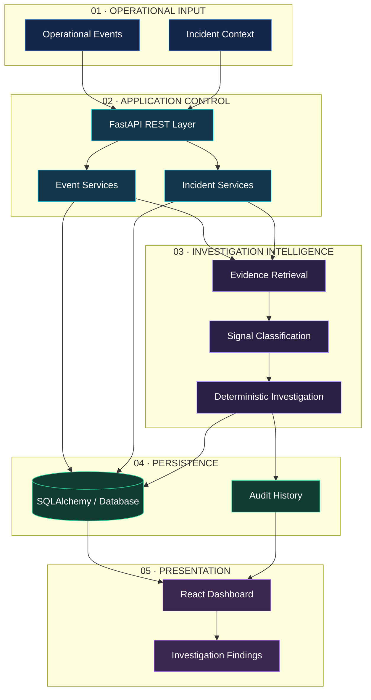
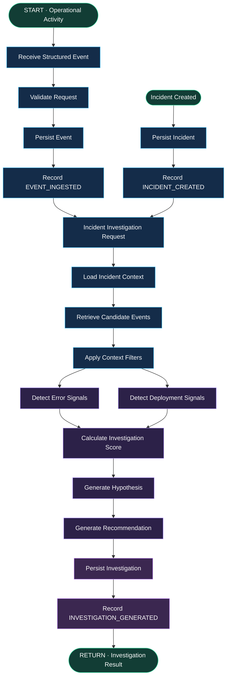
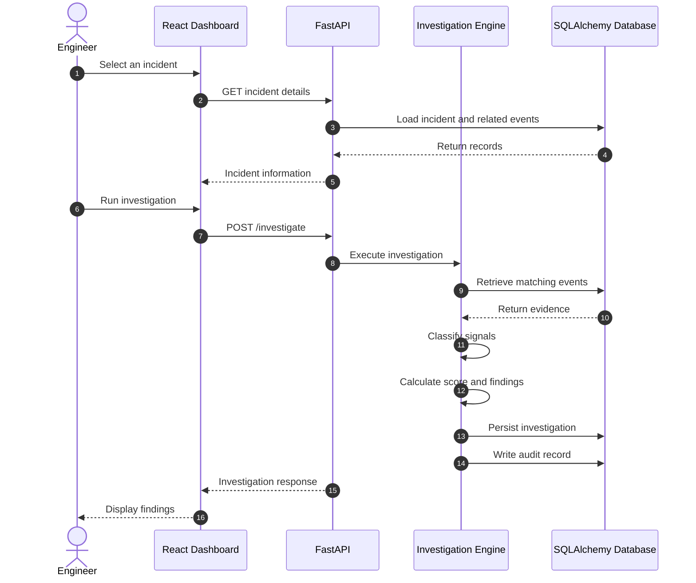
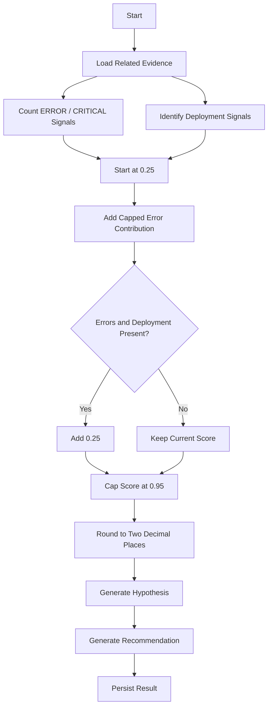
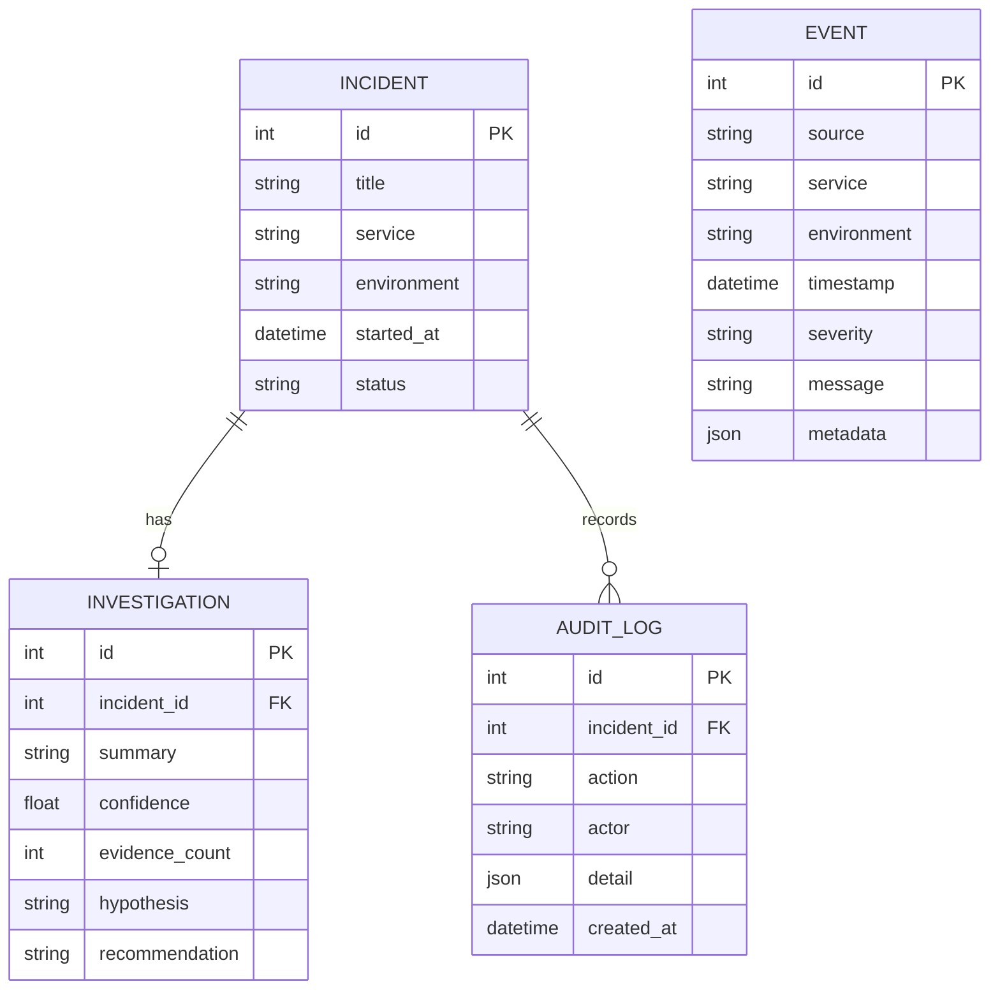
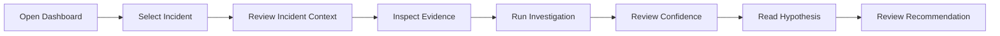
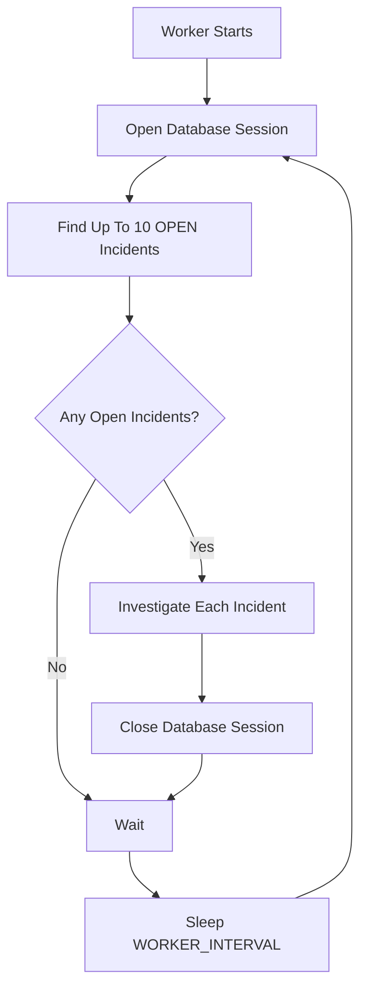
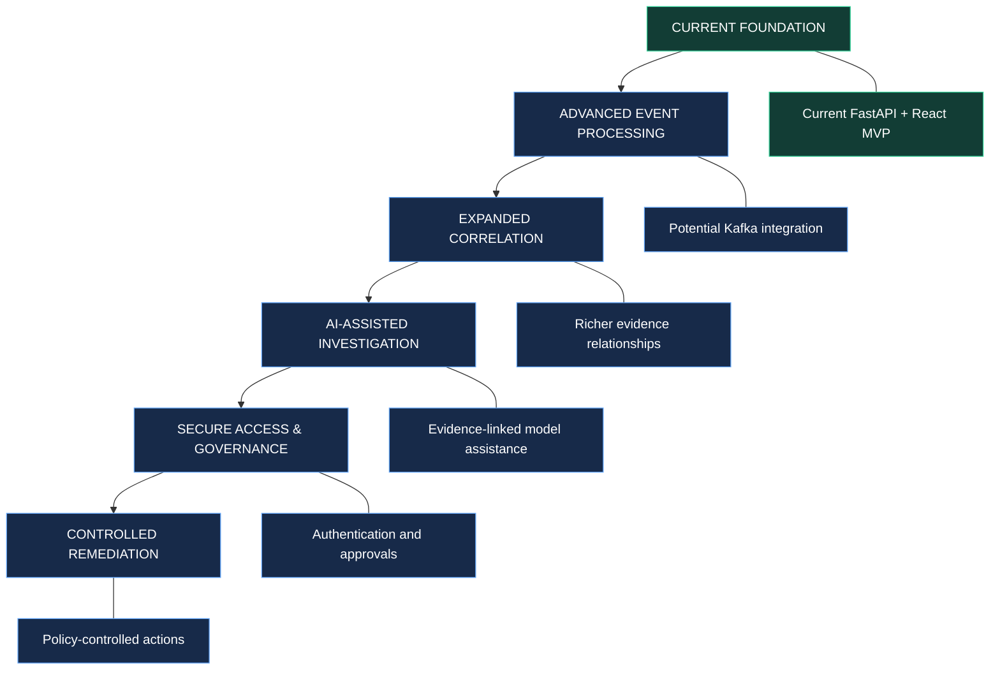

 <div align="center">

# ◈ OPSPILOT AI

### THE EVIDENCE-FIRST OPERATIONS INTELLIGENCE PLATFORM

**Observe. Correlate. Investigate. Understand.**

Turning operational events into structured, traceable incident investigations.

[EXPLORE REPOSITORY](https://github.com/akankshad1712/opspilot-ai) · [DEVELOPER PROFILE](https://github.com/akankshad1712) · [LINKEDIN](https://linkedin.com/in/akanksha-deshmukh-26210b244) · [PORTFOLIO](https://akankshadeshmukh.com)


</div>

---

<div align="center">

### ENGINEERING VISIBILITY FOR OPERATIONAL COMPLEXITY

| EVENT INTELLIGENCE | INCIDENT CONTEXT | EVIDENCE CORRELATION | AUDITABILITY |
|:---:|:---:|:---:|:---:|
| Collect | Organize | Investigate | Trace |

</div>

## 00 — THE PRODUCT

Operational incidents rarely arrive with a complete explanation.

An application may generate hundreds of events across services and environments. Engineers must determine which signals matter, what happened around the incident, and which explanations are supported by available evidence.

**OpsPilot AI** provides a structured incident investigation workflow that brings these activities into one application.

It combines a Python backend, a deterministic investigation engine, persistent data models, audit logging, and a React dashboard.

### The core proposition

> Don't jump from an alert to a conclusion. Build the explanation from evidence.

### What the application implements

| System capability | Implementation |
|---|---|
| Operational event ingestion | REST API |
| Incident creation and retrieval | Incident management endpoints |
| Related-event retrieval | Service, environment, and time filtering |
| Error signal classification | Severity-based rules |
| Deployment signal classification | Source-based rules |
| Investigation generation | Deterministic Python engine |
| Confidence calculation | Bounded heuristic scoring |
| Investigation persistence | SQLAlchemy models |
| Repeated investigation handling | Updates existing investigation |
| Audit history | Persistent audit records |
| Incident dashboard | React and TypeScript |
| Background processing | Separate polling worker |

---

## 01 — VISUAL SYSTEM BLUEPRINT

### The application at a glance



*Conceptual architecture of the implemented application. The layered presentation is a documentation view, not a claim that every layer is a separate deployed service.*

### Architecture responsibility matrix

| Layer | Primary responsibility | Technology |
|---|---|---|
| Presentation | User interaction and investigation display | React, TypeScript |
| API | HTTP request handling | FastAPI |
| Business logic | Event and incident operations | Python |
| Investigation | Evidence selection and signal scoring | Python |
| Persistence | Models and database sessions | SQLAlchemy |
| Storage | Local persistent data | SQLite by default |
| Background execution | Periodic investigation of open incidents | Python worker |

---

## 02 — EVENT-TO-INVESTIGATION LIFECYCLE

### How information moves through the application



### Investigation sequence



---

## 03 — THE INVESTIGATION ENGINE

### Evidence selection strategy

The engine selects related events using the incident's service, environment, and start time.

| Dimension | Current selection rule |
|---|---|
| Service | Event service matches incident service |
| Environment | Event environment matches incident environment |
| Start boundary | 30 minutes before incident start |
| End boundary | 2 hours after incident start |
| Event ordering | Timestamp ascending |

This creates a bounded evidence set before signal evaluation.

### Signal classification

| Signal family | Detection condition | Interpretation |
|---|---|---|
| Error | Severity is `ERROR` | Error event |
| Critical | Severity is `CRITICAL` | Critical event |
| Deployment | Source is `deployment` | Deployment-related event |
| Deploy | Source is `deploy` | Deployment-related event |
| Release | Source is `release` | Release-related event |

### Confidence scoring model

The current engine uses an explicit deterministic scoring heuristic.

| Component | Rule | Maximum contribution |
|---|---|---:|
| Baseline | Initial score | 0.25 |
| Error evidence | 0.05 per error/critical event | 0.30 |
| Deployment correlation | Added when errors and deployment signals both exist | 0.25 |
| Final cap | Maximum permitted score | 0.95 |

```python
score = 0.25

score += min(error_count * 0.05, 0.30)

if has_deployment and has_errors:
    score += 0.25

score = min(score, 0.95)

confidence = round(score, 2)
```

### Decision flow



### Finding interpretation

The engine generates findings based on the observed signals.

| Evidence situation | Current interpretation |
|---|---|
| No qualifying error signals | Insufficient evidence |
| Error signals found | Error-signal hypothesis |
| Deployment and errors found | Possible temporal deployment correlation |
| Repeated investigation | Update existing investigation record |

**Important engineering boundary:** the confidence score is not a calibrated probability. A temporal deployment correlation does not prove causation. Recommendations do not execute remediation.

---

## 04 — DATA ARCHITECTURE

### Persistence model



### Entity responsibility

| Model | Responsibility |
|---|---|
| `Event` | Stores structured operational events |
| `Incident` | Stores incident context and status |
| `Investigation` | Stores generated findings and confidence |
| `AuditLog` | Records application activities |

Events are retrieved through matching attributes and time criteria. The diagram intentionally does not imply a direct event-to-incident foreign-key relationship.

### Audit activity

The application records the following actions:

| Action | Trigger |
|---|---|
| `EVENT_INGESTED` | Event ingestion |
| `INCIDENT_CREATED` | Incident creation |
| `INVESTIGATION_GENERATED` | Investigation execution |

Audit records include an action, actor, detail payload, and timestamp.

---

## 05 — REST API REFERENCE

**Local API base URL**

```text
http://127.0.0.1:8000
```

### Health

| Method | Endpoint | Purpose |
|---|---|---|
| GET | `/health` | API health check |

### Events

| Method | Endpoint | Purpose |
|---|---|---|
| POST | `/api/v1/events` | Ingest event |
| GET | `/api/v1/events` | Retrieve events |

### Incidents

| Method | Endpoint | Purpose |
|---|---|---|
| POST | `/api/v1/incidents` | Create incident |
| GET | `/api/v1/incidents` | List incidents |
| GET | `/api/v1/incidents/{incident_id}` | Retrieve incident details |

### Investigation

| Method | Endpoint | Purpose |
|---|---|---|
| POST | `/api/v1/incidents/{incident_id}/investigate` | Generate investigation |

### Audit

| Method | Endpoint | Purpose |
|---|---|---|
| GET | `/api/v1/incidents/{incident_id}/audit` | Retrieve audit history |

### Interactive API exploration

After starting the backend, open:

**Swagger UI:** `http://127.0.0.1:8000/docs`

---

## 06 — FRONTEND EXPERIENCE

The current React application provides an incident-focused investigation dashboard.

| Interface area | Implemented behavior |
|---|---|
| Incident list | Browse available incidents |
| Incident details | Inspect selected incident |
| Evidence timeline | Review related events |
| Investigation action | Trigger an investigation |
| Confidence display | Review heuristic score |
| Summary | Read generated investigation summary |
| Hypothesis | Review possible explanation |
| Recommendation | View suggested next step |

### User interaction flow



The current frontend API base URL is `http://localhost:8000`.

---

## 07 — OPTIONAL BACKGROUND WORKER

The repository contains a separate Python worker process.

### Current worker behavior



| Property | Current behavior |
|---|---|
| Process | `apps/worker/main.py` |
| Incident filter | OPEN incidents |
| Batch size | Up to 10 |
| Default polling interval | 30 seconds |
| Execution | Separate process |

This is a polling-based prototype worker, not a distributed message queue or production scheduling system.

---

## 08 — TECHNOLOGY STACK

| Category | Technology | Role |
|---|---|---|
| Backend | Python 3.12 | Application logic |
| API | FastAPI 0.115 | REST endpoints |
| Validation | Pydantic | Data validation |
| Persistence | SQLAlchemy 2.0 | ORM |
| Database | SQLite | Default local database |
| Database connectivity | psycopg | PostgreSQL driver dependency |
| Frontend | React 19 | UI |
| Frontend language | TypeScript 5.7 | Typed frontend |
| Build tooling | Vite 6 | Frontend tooling |
| Server | Uvicorn | ASGI server |
| Testing | Pytest | Backend tests |
| API test client | HTTPX | HTTP-level testing |
| Coverage | Coverage.py | Backend coverage |
| Containers | Docker | Container packaging |
| Local orchestration | Docker Compose | API and web startup |
| Version control | Git | Source control |

---

## 09 — REPOSITORY MAP

```text
opspilot-ai/
│
├── apps/
│   │
│   ├── api/
│   │   └── app/
│   │       ├── __init__.py
│   │       ├── config.py
│   │       ├── database.py
│   │       ├── engine.py
│   │       ├── main.py
│   │       ├── models.py
│   │       ├── schemas.py
│   │       └── services.py
│   │
│   ├── web/
│   │   ├── src/
│   │   │   ├── App.tsx
│   │   │   ├── main.tsx
│   │   │   └── styles.css
│   │   ├── index.html
│   │   ├── package.json
│   │   └── vite.config.ts
│   │
│   └── worker/
│       └── main.py
│
├── tests/
│   └── test_api.py
│
├── docs/
├── data/
│
├── .env.example
├── .gitignore
├── Dockerfile
├── docker-compose.yml
├── requirements.txt
├── LICENSE
└── README.md
```

---

## 10 — LOCAL DEVELOPMENT

### Prerequisites

| Dependency | Version |
|---|---|
| Python | 3.12 |
| Node.js | 22 recommended |
| npm | Included with Node.js |
| Git | Recent version |
| Docker | Optional |

### Windows PowerShell installation

**01 — Clone the repository**

```powershell
git clone https://github.com/akankshad1712/opspilot-ai.git

cd opspilot-ai
```

**02 — Create virtual environment**

```powershell
python -m venv .venv

.\.venv\Scripts\Activate.ps1
```

**03 — Install backend dependencies**

```powershell
python -m pip install -r requirements.txt
```

**04 — Create local environment configuration**

```powershell
Copy-Item .env.example .env
```

Default configuration:

```env
DATABASE_URL=sqlite:///./opspilot.db
API_HOST=0.0.0.0
API_PORT=8000
CORS_ORIGINS=http://localhost:5173
```

**05 — Start backend**

```powershell
python -m uvicorn apps.api.app.main:app --reload
```

Backend:

```text
http://127.0.0.1:8000
```

Swagger:

```text
http://127.0.0.1:8000/docs
```

**06 — Start frontend**

Open a second PowerShell terminal:

```powershell
cd C:\Users\hp\Desktop\opspilot-ai\apps\web

npm install

npm run dev
```

Frontend:

```text
http://localhost:5173
```

**07 — Verify services**

| Service | Address |
|---|---|
| Web application | `http://localhost:5173` |
| Backend API | `http://127.0.0.1:8000` |
| API documentation | `http://127.0.0.1:8000/docs` |
| Health endpoint | `http://127.0.0.1:8000/health` |

---

## 11 — DOCKER EXECUTION

The repository includes Docker and Docker Compose configuration for local API and frontend services.

Create the environment file:

```powershell
Copy-Item .env.example .env
```

Build and start:

```powershell
docker compose up --build
```

Stop:

```powershell
docker compose down
```

The optional worker is run separately; it is not part of the current Compose service set.

---

## 12 — TESTING & ENGINEERING VERIFICATION

### Run the backend suite

```powershell
python -m pytest -v
```

### Generate backend coverage

Install Coverage.py:

```powershell
python -m pip install coverage
```

Run branch-aware coverage:

```powershell
python -m coverage run --branch --source=apps.api.app -m pytest -v

python -m coverage report -m
```

### Verified results

| Quality indicator | Result |
|---|---:|
| Backend tests passed | 15 |
| Backend statement coverage | 100% |
| Backend branch coverage | 100% |
| Coverage target | `apps.api.app` |

### Verified coverage by module

| Module | Statement coverage |
|---|---:|
| `config.py` | 100% |
| `database.py` | 100% |
| `engine.py` | 100% |
| `main.py` | 100% |
| `models.py` | 100% |
| `schemas.py` | 100% |
| `services.py` | 100% |
| **Backend total** | **100%** |

### Test coverage areas

- Health endpoint.
- Event ingestion and retrieval.
- Incident creation and retrieval.
- Missing incident handling.
- Related-event filtering.
- Investigation generation.
- Repeated investigation updates.
- Audit history.
- Database session cleanup.

**Coverage qualification:** this is verified backend application-package coverage. It is not a statement about frontend coverage, end-to-end coverage, load testing, or production reliability.

---

## 13 — ENGINEERING DECISIONS

| Decision | Reason |
|---|---|
| REST API architecture | Clear boundary between client and backend |
| FastAPI | Structured API development and validation |
| SQLAlchemy ORM | Explicit database models and relationships |
| SQLite default | Simple local development |
| Deterministic investigation | Reproducible and inspectable behavior |
| Bounded time window | Controls evidence relevance |
| Separate investigation model | Separates incident context from generated findings |
| Audit logging | Records important operational actions |
| Optional polling worker | Demonstrates background execution |
| Pytest and HTTPX | Verifies backend behavior |

---

## 14 — IMPLEMENTATION STATUS

A clear distinction between current capabilities and future work is part of the project's engineering documentation.

| Feature | Status |
|---|---|
| FastAPI application | Implemented |
| Event ingestion API | Implemented |
| Event retrieval API | Implemented |
| Incident creation API | Implemented |
| Incident retrieval API | Implemented |
| Related event retrieval | Implemented |
| Deterministic investigation | Implemented |
| Confidence heuristic | Implemented |
| Hypothesis generation | Implemented |
| Recommendation generation | Implemented |
| Investigation persistence | Implemented |
| Audit logging | Implemented |
| React incident dashboard | Implemented |
| Separate polling worker | Implemented |
| Docker configuration | Implemented |
| Backend automated tests | Implemented |
| Production LLM integration | Not implemented |
| Kafka streaming | Not implemented |
| Redis caching | Not implemented |
| Authentication and RBAC | Not implemented |
| Autonomous remediation | Not implemented |
| Human approval workflow | Not implemented |
| Frontend automated test suite | Not implemented |

---

## 15 — ENGINEERING ROADMAP



Potential next engineering milestones:

1. Validate PostgreSQL deployment and migrations.
2. Add richer event correlation.
3. Introduce integration and end-to-end testing.
4. Add frontend automated tests.
5. Implement authentication and role-based access.
6. Evaluate evidence-linked AI assistance.
7. Design human approval and policy controls.
8. Investigate safe, controlled remediation workflows.

These are roadmap items, not claims about the current application.

---

## 16 — SECURITY & OPERATIONAL CONSIDERATIONS

The current project is an MVP and should not be treated as a production incident-management deployment.

Before production use, the following areas require additional implementation and validation:

| Area | Additional work |
|---|---|
| Authentication | Identity and session management |
| Authorization | Role-based access control |
| Secrets | Secure secret storage |
| Database | Production database configuration and migrations |
| API protection | Rate limiting and abuse controls |
| Observability | Structured application logging and metrics |
| Reliability | Deployment, recovery, and backup procedures |
| Testing | Integration, security, and load testing |
| Remediation | Explicit policy and human approval controls |

Never commit real credentials, tokens, private keys, or production environment files.

---

## 17 — DOCUMENTATION & RESOURCES

| Resource | Link |
|---|---|
| Source repository | [GitHub](https://github.com/akankshad1712/opspilot-ai) |
| API documentation | `/docs` after starting the backend |
| Security policy | [SECURITY.md](SECURITY.md) |
| License | [LICENSE](LICENSE) |

---

## 18 — ABOUT THE DEVELOPER

<div align="center">

# AKANKSHA DESHMUKH

### SOFTWARE DEVELOPER

Interested in backend engineering, full-stack development, API design, application architecture, and practical software engineering.

[](https://github.com/akankshad1712)
[](https://linkedin.com/in/akanksha-deshmukh-26210b244)
[](https://akankshadeshmukh.com)
[](https://leetcode.com/u/Kanksha17/)

</div>

---

<div align="center">

### ◈ OPSPILOT AI

**SEE THE SIGNAL. UNDERSTAND THE INCIDENT. FOLLOW THE EVIDENCE.**

Designed around clarity. Built around evidence. Documented with engineering transparency.

</div>
