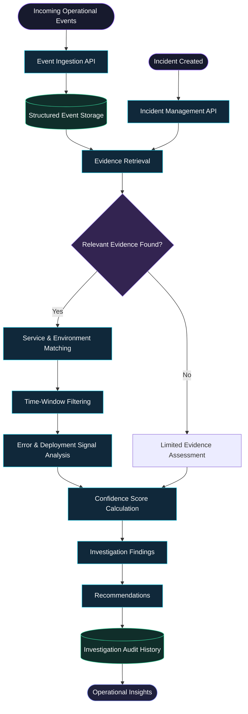
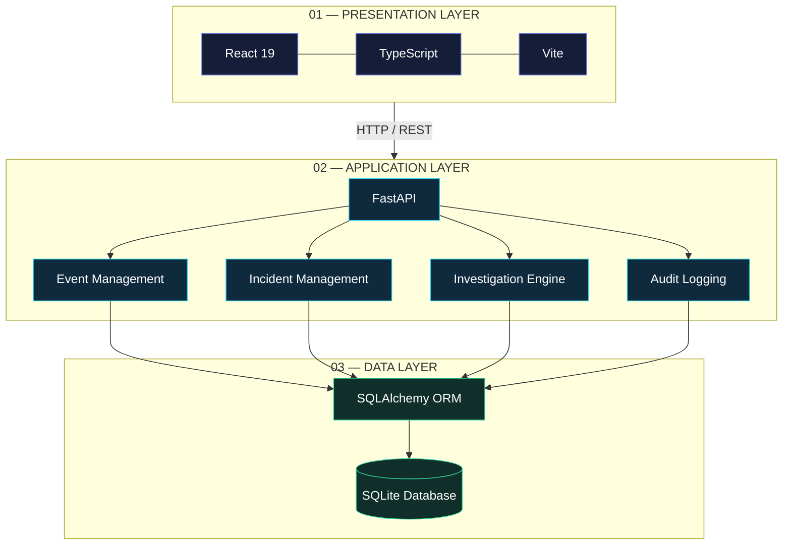

<!--
  OPSPILOT AI
  Premium GitHub Project README
  Visual identity: Midnight / Electric Violet / Cyan
-->

<div align="center">

# ◈ OPSPILOT AI

### THE INTELLIGENCE LAYER FOR OPERATIONAL CLARITY.

**From scattered system events to evidence-backed incident intelligence.**

A modern operations intelligence platform for ingesting events, managing incidents, investigating operational signals, and transforming technical evidence into actionable insights.

<br/>

[](https://www.python.org/)
[](https://fastapi.tiangolo.com/)
[](https://react.dev/)
[](https://www.typescriptlang.org/)
[](https://www.sqlite.org/)

<br/>

[**Explore Repository**](https://github.com/akankshad1712/opspilot-ai)
&nbsp; ◆ &nbsp;
[**Author Profile**](https://github.com/akankshad1712)
&nbsp; ◆ &nbsp;
[**Connect on LinkedIn**](https://linkedin.com/in/akanksha-deshmukh-26210b244)

<br/>

</div>

---

<div align="center">

## ◈ THE BIG IDEA

### Operations should be understandable, not overwhelming.

</div>

Modern software systems generate continuous streams of events, errors, deployments, and operational signals.

The challenge isn't simply collecting those signals. It's understanding which signals matter, how they relate to an incident, and what the evidence actually tells us.

**OpsPilot AI** addresses this challenge through an evidence-first investigation workflow.

Instead of presenting disconnected operational information, the platform connects relevant events to incidents, evaluates investigation signals, calculates confidence, and records the investigation history.

> **Core philosophy:** Every investigation should have evidence. Every recommendation should have context. Every important action should be traceable.

---

# 01 — PRODUCT EXPERIENCE

<div align="center">

### ONE PLATFORM. FOUR OPERATIONAL CAPABILITIES.

</div>

<table>
<tr>
<td width="50%" valign="top">

### ◉ Event Intelligence

Collect and organize operational events through REST APIs.

- Event ingestion
- Structured event metadata
- Service and environment context
- Event retrieval

</td>
<td width="50%" valign="top">

### ◈ Incident Management

Create and manage incidents through a centralized workflow.

- Incident creation
- Incident retrieval
- Incident details
- Related event association

</td>
</tr>
<tr>
<td width="50%" valign="top">

### ⌁ Evidence-Based Investigation

Analyze operational signals using a deterministic investigation engine.

- Related event filtering
- Error and deployment signals
- Confidence scoring
- Investigation recommendations

</td>
<td width="50%" valign="top">

### ◷ Audit Intelligence

Preserve investigation history and operational traceability.

- Incident activity records
- Investigation history
- Audit retrieval
- Structured audit details

</td>
</tr>
</table>

---

# 02 — HOW THE SYSTEM THINKS

<div align="center">

### THE OPSPILOT INVESTIGATION PIPELINE

*From an incoming event to an evidence-backed investigation.*

</div>



### Investigation logic

The current investigation engine uses deterministic rules rather than claiming to rely on a production LLM.

Its workflow includes:

1. Identifying events associated with the incident's service and environment.
2. Filtering relevant events within a defined time window.
3. Evaluating error and deployment signals.
4. Calculating a confidence score from the available evidence.
5. Producing findings and recommendations.
6. Recording investigation activity.

**Current scoring model:** The engine starts with a baseline score, increases it based on relevant error signals and deployment-plus-error combinations, and caps the result at 0.95.

This makes the current investigation workflow understandable, reproducible, and testable.

---

# 03 — SYSTEM ARCHITECTURE

<div align="center">

### MODULAR BY DESIGN. EVIDENCE-DRIVEN BY DEFAULT.

</div>



### Architecture characteristics

| Area | Implementation |
|---|---|
| Frontend | React + TypeScript |
| Backend | FastAPI |
| API style | REST |
| ORM | SQLAlchemy |
| Database | SQLite |
| Investigation | Deterministic evidence-based engine |
| Testing | Pytest |
| Coverage | Coverage.py |
| Containerization | Docker |

---

# 04 — TECHNOLOGY ECOSYSTEM

<div align="center">

### BUILT WITH A PRACTICAL, MODERN ENGINEERING STACK.

</div>

| Technology | Role in the project |
|---|---|
| Python | Backend development |
| FastAPI | REST API and application layer |
| SQLAlchemy | Database interaction and ORM |
| SQLite | Default persistent storage |
| React | Frontend interface |
| TypeScript | Frontend type safety |
| Vite | Frontend development and build tooling |
| Pytest | Automated backend testing |
| Coverage.py | Test coverage measurement |
| Docker | Containerization support |
| Git & GitHub | Version control and collaboration |

---

# 05 — API REFERENCE

<div align="center">

### A CLEAN REST INTERFACE FOR OPERATIONAL WORKFLOWS.

</div>

**Base URL**

```text
http://127.0.0.1:8000
```

| Method | Endpoint | Responsibility |
|:---:|---|---|
| `GET` | `/health` | Application health check |
| `POST` | `/api/v1/events` | Ingest an operational event |
| `GET` | `/api/v1/events` | Retrieve operational events |
| `GET` | `/api/v1/incidents` | List incidents |
| `POST` | `/api/v1/incidents` | Create an incident |
| `GET` | `/api/v1/incidents/{incident_id}` | Retrieve incident details |
| `POST` | `/api/v1/incidents/{incident_id}/investigate` | Run an investigation |
| `GET` | `/api/v1/incidents/{incident_id}/audit` | Retrieve audit history |

### Interactive API explorer

Once the backend is running, open:

[**Open Swagger API Documentation →**](http://127.0.0.1:8000/docs)

---

# 06 — PROJECT STRUCTURE

```text
opspilot-ai/
│
├── apps/
│   │
│   ├── api/
│   │   └── app/
│   │       ├── config.py
│   │       ├── database.py
│   │       ├── engine.py
│   │       ├── main.py
│   │       ├── models.py
│   │       ├── schemas.py
│   │       └── services.py
│   │
│   ├── web/
│   │   ├── src/
│   │   │   ├── App.tsx
│   │   │   ├── main.tsx
│   │   │   └── styles.css
│   │   ├── index.html
│   │   ├── package.json
│   │   └── vite.config.ts
│   │
│   └── worker/
│       └── main.py
│
├── data/
│
├── docs/
│   ├── architecture.md
│   ├── data-model.md
│   ├── operations.md
│   └── security.md
│
├── tests/
│   └── test_api.py
│
├── .env.example
├── .gitignore
├── Dockerfile
├── docker-compose.yml
├── requirements.txt
└── README.md
```

---

# 07 — GETTING STARTED

<div align="center">

### YOUR LOCAL OPSPILOT ENVIRONMENT IN A FEW STEPS.

</div>

### Requirements

- Python 3.10+
- Node.js and npm
- Git

### Step 01 — Clone the repository

```bash
git clone https://github.com/akankshad1712/opspilot-ai.git

cd opspilot-ai
```

### Step 02 — Configure the backend

Create a Python virtual environment:

**Windows PowerShell**

```powershell
python -m venv .venv
```

Activate the environment:

```powershell
.\.venv\Scripts\Activate.ps1
```

Install Python dependencies:

```powershell
pip install -r requirements.txt
```

### Step 03 — Start the backend

From the project root:

```powershell
python -m uvicorn apps.api.app.main:app --reload
```

Backend:

```text
http://127.0.0.1:8000
```

API documentation:

```text
http://127.0.0.1:8000/docs
```

### Step 04 — Configure the frontend

Open a separate terminal:

```powershell
cd apps/web
```

Install frontend dependencies:

```powershell
npm install
```

Start the frontend:

```powershell
npm run dev
```

Frontend:

```text
http://localhost:5173
```

### Step 05 — Verify the application

Check the health endpoint:

```text
http://127.0.0.1:8000/health
```

Open the frontend and Swagger interface to explore the application.

---

# 08 — TESTING & QUALITY ENGINEERING

<div align="center">

### QUALITY IS MEASURED, NOT ASSUMED.

</div>

OpsPilot AI includes automated backend tests covering the core application workflows.

### Run the test suite

```powershell
python -m pytest -v
```

### Generate coverage results

```powershell
python -m coverage run --branch --source=apps.api.app -m pytest -v

python -m coverage report -m
```

### Verified backend results

<table>
<tr>
<td align="center" width="33%">

# 15

**Passing Tests**

</td>
<td align="center" width="33%">

# 100%

**Statement Coverage**

</td>
<td align="center" width="33%">

# 100%

**Branch Coverage**

</td>
</tr>
</table>

Coverage was measured across the `apps.api.app` backend package.

The test suite covers:

- Health endpoint
- Event ingestion and retrieval
- Incident creation and retrieval
- Investigation workflows
- Related event filtering
- Repeated investigations
- Audit history
- Database session lifecycle

*These coverage figures apply to the backend package, not the React frontend.*

---

# 09 — ENGINEERING PRINCIPLES

| Principle | How OpsPilot AI applies it |
|---|---|
| Evidence First | Investigations use related operational events |
| Deterministic Logic | Current scoring and investigation rules are reproducible |
| Traceability | Audit records preserve investigation activities |
| Modularity | API, frontend, worker, and data concerns are separated |
| Testability | Backend behavior is verified with automated tests |
| Transparency | Findings and confidence are based on explicit signals |

---

# 10 — ROADMAP

<div align="center">

### THE NEXT EVOLUTION OF OPERATIONAL INTELLIGENCE.

</div>

The following are planned enhancements, not features claimed as complete.


### Planned directions

- [ ] Kafka-based event streaming
- [ ] Redis caching and performance improvements
- [ ] PostgreSQL deployment configuration
- [ ] AI/LLM-assisted incident analysis
- [ ] Advanced observability integrations
- [ ] Authentication and role-based access control
- [ ] Automated incident remediation
- [ ] Expanded frontend and integration tests

---

# 11 — PROJECT DOCUMENTATION

Explore the technical documentation:

| Document | Focus |
|---|---|
| [Architecture](docs/architecture.md) | System architecture |
| [Data Model](docs/data-model.md) | Database structure |
| [Operations](docs/operations.md) | Operational guidance |
| [Security](docs/security.md) | Security considerations |

---

# 12 — ABOUT THE CREATOR

<div align="center">

## AKANKSHA DESHMUKH

### Software Developer | Backend Engineering | Full-Stack Development

Building practical software systems with an interest in backend architecture, APIs, distributed systems concepts, and AI-assisted engineering.

<br/>

[](https://github.com/akankshad1712)

[](https://linkedin.com/in/akanksha-deshmukh-26210b244)

[](https://akankshadeshmukh.com)

[](https://leetcode.com/u/Kanksha17/)

</div>

---

<div align="center">

# ◈ OPSPILOT AI

### SEE THE SIGNAL. UNDERSTAND THE INCIDENT. FOLLOW THE EVIDENCE.

**Turning operational complexity into actionable clarity.**

<br/>

Built with curiosity, engineering discipline, and a focus on meaningful software.

<br/>

<sub>© 2026 Akanksha Deshmukh · Licensed under the MIT License</sub>

</div>
