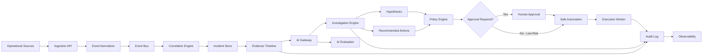
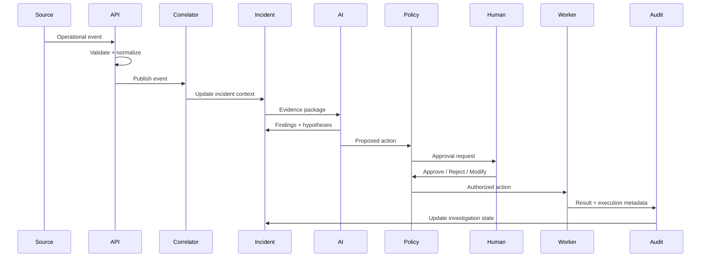
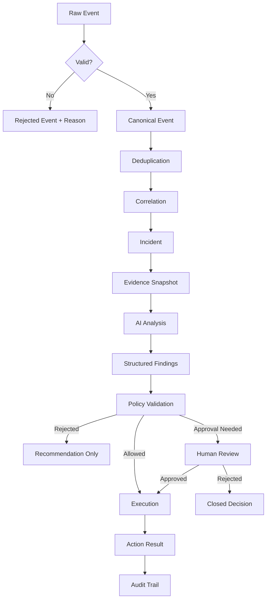
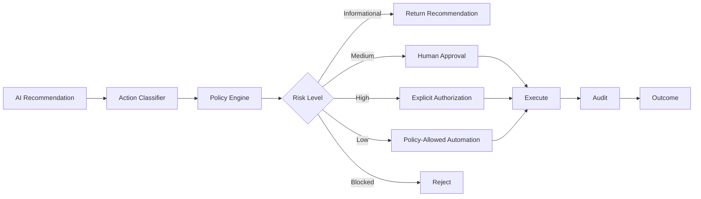
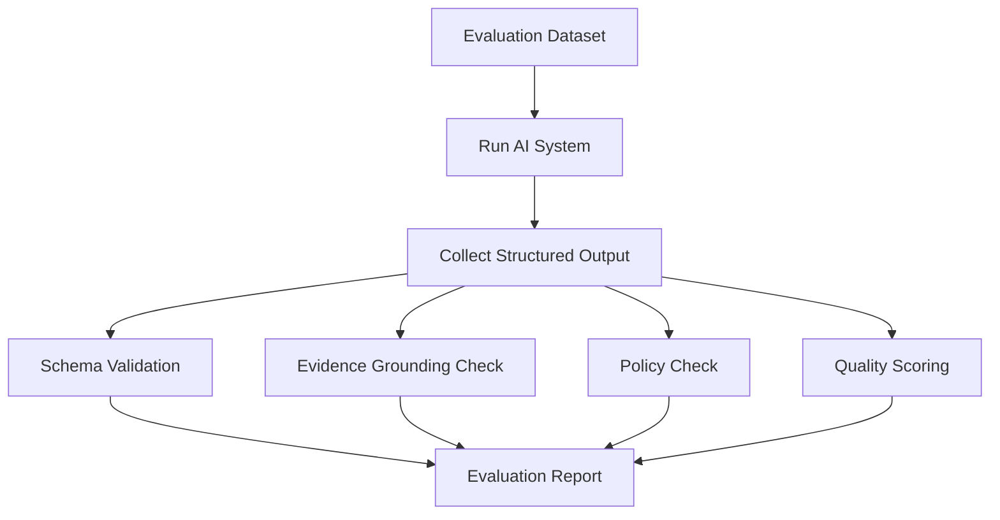

# OpsPilot AI

### Evidence-First Operations Intelligence

> **Investigate incidents with evidence. Reason with context. Automate only when it is safe.**

OpsPilot AI is a production-oriented architecture for turning fragmented operational signals into a structured incident investigation workflow.

It is designed around a simple principle:

**AI should help engineers understand what happened — not invent what happened.**

The platform brings together application logs, API failures, deployment events, support signals, metrics, and human context. It correlates those signals into an investigation timeline, prepares evidence-grounded analysis, proposes next actions, and keeps every important decision auditable.

This repository is intentionally structured as a real engineering system: clear boundaries, explicit contracts, failure handling, security controls, evaluation, observability, and human approval.

---

## At a Glance

| Layer | Responsibility |
|---|---|
| Ingestion | Accept operational events and normalize them |
| Correlation | Connect related signals into incidents |
| Investigation | Build an evidence timeline and context |
| AI Reasoning | Summarize evidence and generate hypotheses |
| Decision Support | Rank hypotheses and recommend next actions |
| Policy | Decide what the system may or may not execute |
| Automation | Execute only approved, safe actions |
| Audit | Record decisions, actions, outcomes, and evidence |
| Evaluation | Measure AI behavior independently from application tests |
| Observability | Make system behavior measurable and diagnosable |

### Core design goals

- **Evidence before explanation**
- **Human approval before consequential automation**
- **Deterministic workflows around probabilistic AI**
- **Traceable AI outputs**
- **Explicit security boundaries**
- **Recoverable failures**
- **Measurable quality**
- **Small, composable services**
- **Documentation as part of the architecture**

---

# 01 · Why OpsPilot?

Modern incidents rarely arrive as one clean error message.

A single production problem may leave traces across:

```text
Application logs
      │
      ├── API errors
      ├── database latency
      ├── deployment events
      ├── infrastructure metrics
      ├── support tickets
      └── human observations
```

The difficult part is often not collecting another log.

The difficult part is answering:

> **What changed, what is actually supported by evidence, what is only a hypothesis, and what should happen next?**

OpsPilot is designed around that investigation problem.

---

# 02 · Product Philosophy

```text
             ┌───────────────────────────┐
             │      Operational Data     │
             │ logs • APIs • deploys     │
             │ metrics • tickets • events│
             └─────────────┬─────────────┘
                           │
                           ▼
             ┌───────────────────────────┐
             │       Normalization       │
             │ schema • validation       │
             │ deduplication • metadata  │
             └─────────────┬─────────────┘
                           │
                           ▼
             ┌───────────────────────────┐
             │       Correlation         │
             │ time • service • trace    │
             │ deployment • dependency   │
             └─────────────┬─────────────┘
                           │
                           ▼
             ┌───────────────────────────┐
             │    Evidence Timeline      │
             │ what happened + when      │
             │ source + confidence       │
             └─────────────┬─────────────┘
                           │
                           ▼
             ┌───────────────────────────┐
             │       AI Analysis         │
             │ summarize • hypothesize   │
             │ classify • recommend      │
             └─────────────┬─────────────┘
                           │
                           ▼
             ┌───────────────────────────┐
             │       Human Review        │
             │ approve • reject • modify │
             └─────────────┬─────────────┘
                           │
                    approved only
                           │
                           ▼
             ┌───────────────────────────┐
             │      Safe Automation      │
             │ policy • action • result  │
             └─────────────┬─────────────┘
                           │
                           ▼
             ┌───────────────────────────┐
             │      Audit + Learning     │
             │ decision • evidence •     │
             │ outcome • evaluation      │
             └───────────────────────────┘
```

The architecture deliberately separates **facts**, **inferences**, **recommendations**, and **actions**.

---

# 03 · System Architecture



### Architectural boundary

The LLM/AI layer is **not** the source of truth.

The source of truth is the operational evidence and the system's persisted state.

The AI layer operates on bounded context supplied by the application.

---

# 04 · Investigation Lifecycle



---

# 05 · The Evidence Model

Every investigation should distinguish between:

### Observed fact

Something directly supported by a source.

```text
Example:
Deployment 7f31 was released at 14:02 UTC.
```

### Correlated signal

A relationship derived from multiple observed facts.

```text
Example:
Error rate increased within five minutes of deployment 7f31.
```

### Hypothesis

A possible explanation that still requires validation.

```text
Example:
Deployment 7f31 may have introduced the regression.
```

### Recommendation

A proposed next step.

```text
Example:
Compare error traces before and after deployment 7f31.
```

### Action

An operation that changes a system.

```text
Example:
Rollback deployment 7f31.
```

This distinction prevents a generated explanation from silently becoming an operational fact.

---

# 06 · AI Architecture

```text
                  ┌───────────────────────┐
                  │     Incident Context  │
                  └───────────┬───────────┘
                              │
                              ▼
                  ┌───────────────────────┐
                  │   Context Builder      │
                  │ scope + evidence       │
                  └───────────┬───────────┘
                              │
                              ▼
                  ┌───────────────────────┐
                  │      AI Gateway        │
                  │ model • timeout •      │
                  │ retries • token policy │
                  └───────────┬───────────┘
                              │
                              ▼
                  ┌───────────────────────┐
                  │ Structured AI Output   │
                  │ findings               │
                  │ hypotheses             │
                  │ confidence             │
                  │ citations              │
                  │ recommendations        │
                  └───────────┬───────────┘
                              │
                              ▼
                  ┌───────────────────────┐
                  │   Validation Layer    │
                  │ schema + policy +     │
                  │ evidence references   │
                  └───────────┬───────────┘
                              │
                              ▼
                  ┌───────────────────────┐
                  │     Application       │
                  │ persists / displays / │
                  │ routes for approval   │
                  └───────────────────────┘
```

### Important AI boundary

The model can propose.

The application decides.

The policy engine authorizes.

The worker executes.

The audit layer records.

---

# 07 · Data Flow



---

# 08 · Repository Structure

```text
opspilot-ai/
│
├── README.md
├── SECURITY.md
├── LICENSE
├── .env.example
├── .gitignore
├── docker-compose.yml
│
├── apps/
│   ├── api/
│   ├── worker/
│   ├── ai_gateway/
│   └── web/
│
├── packages/
│   ├── domain/
│   ├── contracts/
│   ├── policies/
│   └── telemetry/
│
├── infrastructure/
│   ├── docker/
│   ├── postgres/
│   ├── kafka/
│   └── github-actions/
│
├── tests/
│   ├── unit/
│   ├── integration/
│   ├── contract/
│   ├── evaluation/
│   └── e2e/
│
├── scripts/
│
├── data/
│
└── docs/
    ├── 00-overview.md
    ├── 01-requirements.md
    ├── 02-system-design.md
    ├── 03-data-model.md
    ├── 04-api-contracts.md
    ├── 05-ai-architecture.md
    ├── 06-security.md
    ├── 07-reliability.md
    ├── 08-observability.md
    ├── 09-evaluation.md
    ├── 10-adr.md
    ├── 11-threat-model.md
    ├── 12-capacity-planning.md
    └── 13-runbooks.md
```

The repository is intentionally separated into application code, reusable domain contracts, infrastructure, tests, and architecture documentation.

---

# 09 · Data Model

The logical model is organized around an investigation rather than a single log record.

```text
┌────────────────┐
│    incidents   │
└───────┬────────┘
        │
        ├───────────────┐
        ▼               ▼
┌──────────────┐  ┌───────────────┐
│   evidence   │  │ hypotheses    │
└──────┬───────┘  └───────┬───────┘
       │                  │
       ▼                  ▼
┌──────────────┐  ┌───────────────┐
│ event_refs   │  │ recommendations│
└──────────────┘  └───────┬───────┘
                           │
                           ▼
                    ┌─────────────┐
                    │   actions   │
                    └──────┬──────┘
                           │
                           ▼
                    ┌─────────────┐
                    │ audit_events│
                    └─────────────┘
```

### Core entities

| Entity | Purpose |
|---|---|
| `incidents` | Investigation lifecycle and state |
| `events` | Normalized operational signals |
| `evidence` | Evidence selected for an investigation |
| `hypotheses` | Candidate explanations |
| `recommendations` | Proposed next steps |
| `actions` | Authorized operational actions |
| `audit_events` | Immutable decision/action history |
| `users` | Identity and access |
| `policies` | Automation constraints |
| `evaluations` | AI quality measurements |

The complete logical data model is documented in `docs/03-data-model.md`.

---

# 10 · API Design

The API is organized around resources rather than model prompts.

```text
POST   /api/v1/events
POST   /api/v1/incidents
GET    /api/v1/incidents/{incident_id}

GET    /api/v1/incidents/{incident_id}/timeline
GET    /api/v1/incidents/{incident_id}/evidence

POST   /api/v1/incidents/{incident_id}/investigate
GET    /api/v1/incidents/{incident_id}/hypotheses

GET    /api/v1/incidents/{incident_id}/recommendations

POST   /api/v1/actions/{action_id}/approve
POST   /api/v1/actions/{action_id}/reject

GET    /api/v1/audit/events
GET    /api/v1/health
GET    /api/v1/ready
```

The API contract documentation lives in:

`docs/04-api-contracts.md`

---

# 11 · Safety Architecture

Automation is treated as a controlled capability.



### Examples of controls

- Authentication
- Authorization
- Role-based access
- Request validation
- Rate limiting
- Action allowlists
- Idempotency
- Approval workflows
- Audit trails
- Timeouts
- Retry limits
- Secret isolation
- Structured logging

The system should fail toward **non-execution**, not uncontrolled execution.

---

# 12 · Reliability

A production system should expect failure.

```text
External API timeout
        │
        ▼
      Retry
        │
        ├── success ──► continue
        │
        ▼
   Retry exhausted
        │
        ▼
   Dead-letter path
        │
        ▼
   Audit + alert
```

### Reliability principles

**Idempotency**

Repeated events or requests should not accidentally create duplicate operational effects.

**Timeouts**

External dependencies must have bounded execution time.

**Retries**

Retries should be selective and bounded.

**Dead-letter handling**

Messages that cannot be processed should remain inspectable instead of disappearing.

**Graceful degradation**

If AI is unavailable, deterministic incident ingestion and investigation state should remain usable.

**Recovery**

Every asynchronous workflow should have a recovery path.

---

# 13 · Observability

Three signals form the operational foundation:

```text
                 ┌──────────────┐
                 │   Metrics    │
                 └──────┬───────┘
                        │
┌──────────────┐   ┌───▼────┐   ┌──────────────┐
│     Logs     │──►│ Service │◄──│    Traces    │
└──────────────┘   └─────────┘   └──────────────┘
                        │
                        ▼
                 Investigation
```

Important measurements include:

- Request latency
- Error rate
- Queue depth
- Worker failures
- AI latency
- AI token usage
- Model failure rate
- Evaluation scores
- Action approval rate
- Action failure rate
- Event processing delay
- Incident resolution duration

The objective is not simply to know that the system is down.

The objective is to understand **where, why, and what happened next**.

---

# 14 · AI Evaluation

Traditional software tests are not enough for AI behavior.

The evaluation layer should test questions such as:

```text
Did the model use the supplied evidence?
Did it invent unsupported facts?
Did it distinguish fact from hypothesis?
Did it cite the correct evidence?
Did it produce valid structured output?
Did it recommend an action outside policy?
Did it remain useful when evidence was incomplete?
```

A conceptual evaluation pipeline:



Evaluation datasets should be versioned.

Changes to prompts, models, retrieval logic, or policies should be measurable rather than judged only by intuition.

---

# 15 · Security Model

Security is part of the system design, not a final checklist.

```text
Identity
   │
   ▼
Authentication
   │
   ▼
Authorization / RBAC
   │
   ▼
Resource Access
   │
   ▼
Policy Validation
   │
   ▼
Audited Action
```

Security boundaries include:

- API authentication
- RBAC
- Secret management
- Input validation
- Dependency controls
- Rate limiting
- Audit logging
- Secure defaults
- Least privilege
- Network isolation
- Safe action policies

See `SECURITY.md` and `docs/06-security.md`.

---

# 16 · Failure Modes

OpsPilot explicitly considers failure as part of normal operation.

| Failure | Expected behavior |
|---|---|
| Invalid event | Reject with structured reason |
| Duplicate event | Deduplicate safely |
| Database unavailable | Fail without losing uncommitted work |
| AI provider unavailable | Preserve deterministic workflow |
| AI timeout | Return controlled failure |
| Invalid AI output | Reject before persistence/action |
| Unauthorized action | Block |
| Worker crash | Retry/recover through queue |
| Action failure | Persist result and surface failure |
| Missing evidence | State uncertainty rather than inventing evidence |

---

# 17 · Decision Records

Architectural decisions are documented instead of hidden inside implementation.

Examples include:

```text
Why event-driven processing?
Why PostgreSQL?
Why an AI gateway?
Why structured AI output?
Why human approval?
Why evidence lineage?
Why separate evaluation from application tests?
```

Decision records live in:

`docs/10-adr.md`

This makes the reasoning behind the architecture reviewable.

---

# 18 · Local Development

The repository is designed to support local development through Docker-based infrastructure.

```bash
git clone https://github.com/akankshad1712/opspilot-ai.git
cd opspilot-ai

cp .env.example .env

docker compose up --build
```

The exact service implementation and environment requirements will evolve as the system is implemented.

---

# 19 · Development Workflow

```text
Issue
  │
  ▼
Design
  │
  ▼
Implementation
  │
  ▼
Unit Tests
  │
  ▼
Integration Tests
  │
  ▼
Contract Tests
  │
  ▼
AI Evaluation
  │
  ▼
Security Review
  │
  ▼
Observability Review
  │
  ▼
Pull Request
  │
  ▼
CI
  │
  ▼
Merge
```

A feature is not considered complete simply because the happy path works.

The surrounding failure modes, tests, observability, and documentation matter too.

---

# 20 · Testing Strategy

```text
                  ┌──────────────┐
                  │    E2E       │
                  └──────┬───────┘
                         │
                  ┌──────▼───────┐
                  │ Integration  │
                  └──────┬───────┘
                         │
                  ┌──────▼───────┐
                  │   Contract   │
                  └──────┬───────┘
                         │
                  ┌──────▼───────┐
                  │     Unit     │
                  └──────────────┘
```

AI-specific evaluation runs alongside conventional software testing.

The objective is to validate both:

1. **Does the software behave correctly?**
2. **Does the AI behave acceptably within defined boundaries?**

---

# 21 · Performance Thinking

Capacity planning starts with measurable assumptions.

```text
Incoming events
       │
       ▼
 Ingestion rate
       │
       ▼
 Queue capacity
       │
       ▼
 Worker throughput
       │
       ▼
 Database write capacity
       │
       ▼
 AI request capacity
```

No performance number is presented here as a measured benchmark.

Production capacity should be derived from actual load tests, workload characteristics, infrastructure limits, and observed bottlenecks.

See `docs/12-capacity-planning.md`.

---

# 22 · Runbooks

Operational knowledge should be executable by another engineer.

Runbooks cover scenarios such as:

- API unavailable
- Queue backlog
- Database connectivity failure
- AI provider outage
- Worker crash loop
- Duplicate event spike
- High latency
- Failed remediation
- Audit inconsistency
- Evaluation regression

See:

`docs/13-runbooks.md`

---

# 23 · Documentation Map

| Document | Purpose |
|---|---|
| `00-overview.md` | System context |
| `01-requirements.md` | Functional and non-functional requirements |
| `02-system-design.md` | Architecture decisions and boundaries |
| `03-data-model.md` | Entities and relationships |
| `04-api-contracts.md` | API design |
| `05-ai-architecture.md` | AI integration and boundaries |
| `06-security.md` | Security architecture |
| `07-reliability.md` | Failure handling and recovery |
| `08-observability.md` | Metrics, logs, traces |
| `09-evaluation.md` | AI evaluation strategy |
| `10-adr.md` | Architecture decision records |
| `11-threat-model.md` | Threat analysis |
| `12-capacity-planning.md` | Capacity assumptions |
| `13-runbooks.md` | Operational procedures |

---

# 24 · Engineering Principles

### 01 — Evidence over confidence

A confident answer without evidence is still an unreliable answer.

### 02 — AI is a component, not the architecture

The surrounding software determines what the AI is allowed to see, decide, and do.

### 03 — Human control for consequential actions

The system should make automation safer, not make humans disappear from important decisions.

### 04 — Every important action leaves a trail

If the system makes or executes a meaningful decision, the reasoning context and outcome should be recoverable.

### 05 — Failure is designed, not discovered

Timeouts, retries, duplicate events, provider failures, malformed AI responses, and partial execution are architectural cases.

### 06 — Measure before claiming

Performance, accuracy, reliability, and AI quality should be reported from actual measurements.

---

# 25 · Project Status

**Current repository stage:** Architecture and engineering documentation foundation.

The repository currently establishes:

- System architecture
- Data model
- API boundaries
- AI architecture
- Security model
- Reliability model
- Observability strategy
- Evaluation strategy
- Threat model
- Capacity planning approach
- Operational runbooks
- Decision-record structure

Implementation should be added incrementally and documented as it becomes real.

No production benchmark, accuracy percentage, uptime figure, or completed feature should be claimed unless it has actually been implemented and measured.

---

# 26 · Roadmap

```text
FOUNDATION
   │
   ├── Repository architecture
   ├── Domain contracts
   └── Documentation
   │
   ▼
CORE PLATFORM
   │
   ├── FastAPI
   ├── PostgreSQL
   ├── Event ingestion
   └── Incident lifecycle
   │
   ▼
INTELLIGENCE
   │
   ├── Evidence correlation
   ├── AI gateway
   ├── Investigation engine
   └── Structured findings
   │
   ▼
SAFE AUTOMATION
   │
   ├── Policy engine
   ├── Human approval
   ├── Action workers
   └── Audit trail
   │
   ▼
PRODUCTION HARDENING
   │
   ├── Observability
   ├── Evaluation
   ├── Security testing
   ├── Load testing
   └── CI/CD
```

---

# 27 · Repository Identity

**Project:** OpsPilot AI  
**Focus:** Evidence-first incident intelligence  
**Architecture:** Event-driven, API-first, policy-controlled  
**AI principle:** Grounded reasoning with explicit uncertainty  
**Automation principle:** Approval-aware and auditable  
**Engineering principle:** Reliability before convenience

---

## Built to be understandable by humans.

The most valuable systems are not the ones with the most complicated diagrams.

They are the ones where another engineer can answer:

**What is happening?**

**Why is it happening?**

**What evidence supports that conclusion?**

**What can the system safely do?**

**Who approved it?**

**What happened after it ran?**

OpsPilot AI is designed around those questions.
