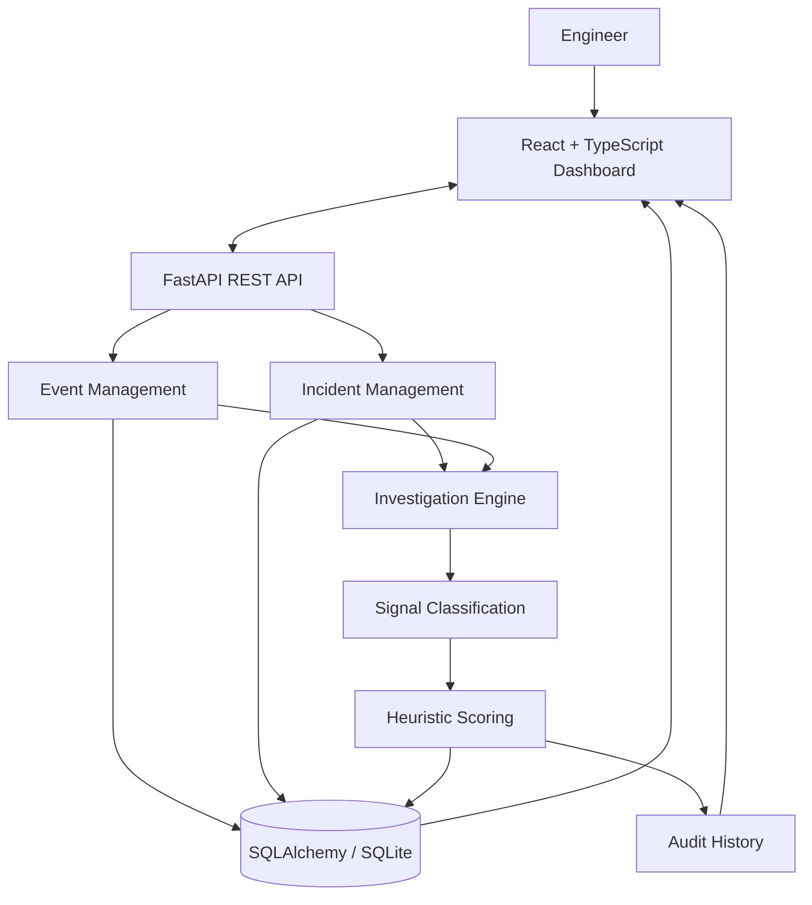

 <div align="center">

# ◈ OPSPILOT AI

### EVIDENCE-FIRST OPERATIONS INTELLIGENCE

**From operational signals to structured investigations.**

A full-stack incident investigation platform that organizes operational events, identifies relevant signals, generates evidence-based findings and maintains an auditable investigation history.

[EXPLORE PROJECT](https://github.com/akankshad1712/opspilot-ai) · [DEVELOPER PROFILE](https://github.com/akankshad1712) · [LINKEDIN](https://linkedin.com/in/akanksha-deshmukh-26210b244) · [PORTFOLIO](https://akankshadeshmukh.com)


</div>

---

## THE IDEA

Operational incidents generate events, errors and deployment signals. Understanding what happened requires more than simply viewing logs.

**OpsPilot AI** brings incident context, related operational events, investigation logic and audit history into one application.

It is designed around a simple engineering principle:

> Every investigation should be understandable, traceable and grounded in available evidence.

### Product capabilities

| Capability | What it does |
|---|---|
| Event ingestion | Accepts and stores operational events |
| Incident management | Creates and retrieves incident records |
| Evidence correlation | Filters events using service, environment and time |
| Signal detection | Identifies error and deployment-related events |
| Investigation engine | Generates summaries, hypotheses and recommendations |
| Confidence scoring | Calculates a bounded heuristic score |
| Audit history | Records important application activities |
| Interactive dashboard | Presents incidents and investigation results |

---

## SYSTEM ARCHITECTURE

A clear separation between the user interface, API, investigation logic and persistence layer.



### Engineering responsibilities

| Component | Responsibility |
|---|---|
| Frontend | Incident browsing and investigation results |
| API layer | Request handling and validation |
| Backend services | Event and incident operations |
| Investigation engine | Evidence filtering and signal analysis |
| ORM | Database models and relationships |
| Database | Persistent application records |
| Worker | Optional periodic processing of open incidents |

---

## INVESTIGATION WORKFLOW

```mermaid
flowchart LR
    A["Operational Events"] --> B["Event Ingestion"]
    B --> C["Incident Context"]
    C --> D["Evidence Filtering"]
    D --> E["Signal Detection"]
    E --> F["Confidence Scoring"]
    F --> G["Investigation Findings"]
    G --> H["Database Persistence"]
    H --> I["Audit History"]
    I --> J["Dashboard"]
```



### How the investigation works

1. **Collect:** Operational events enter through the REST API.
2. **Contextualize:** The incident provides service, environment and start-time information.
3. **Filter:** Related events are selected using matching service, environment and a bounded time window.
4. **Analyze:** The engine identifies error and deployment-related signals.
5. **Evaluate:** A deterministic scoring heuristic calculates a confidence score.
6. **Record:** Investigation findings and audit activities are persisted.
7. **Present:** The dashboard displays the resulting summary, hypothesis and recommendation.

---

## INVESTIGATION LOGIC

The current investigation engine uses deterministic Python rules rather than an external LLM.

### Evidence selection

| Filter | Current rule |
|---|---|
| Service | Must match the incident service |
| Environment | Must match the incident environment |
| Time range | 30 minutes before to 2 hours after incident start |
| Ordering | Timestamp ascending |

### Signal detection

- Error signals: `ERROR` and `CRITICAL` severity.
- Deployment signals: `deployment`, `deploy` and `release` sources.

### Confidence scoring

| Scoring component | Contribution |
|---|---:|
| Initial score | 0.25 |
| Each error/critical event | +0.05 |
| Maximum error contribution | +0.30 |
| Deployment and error signals together | +0.25 |
| Maximum final score | 0.95 |

The score is rounded to two decimal places.

**Engineering note:** This score is a heuristic indicator, not a calibrated probability or proof of root cause. Deployment correlation does not establish causation. Recommendations are informational; the application does not execute remediation.

---

## DATA & AUDITABILITY

The application uses SQLAlchemy models to organize its persistent data.

| Model | Purpose |
|---|---|
| `Event` | Operational event records |
| `Incident` | Incident details and status |
| `Investigation` | Summary, hypothesis, recommendation and score |
| `AuditLog` | History of important application activities |

### Recorded audit actions

- `EVENT_INGESTED`
- `INCIDENT_CREATED`
- `INVESTIGATION_GENERATED`

Repeated investigation requests update the existing investigation record rather than creating a separate investigation for the same incident.

---

## API REFERENCE

**Base URL:** `http://127.0.0.1:8000`

| Method | Endpoint | Function |
|---|---|---|
| GET | `/health` | Health check |
| POST | `/api/v1/events` | Ingest event |
| GET | `/api/v1/events` | Retrieve events |
| POST | `/api/v1/incidents` | Create incident |
| GET | `/api/v1/incidents` | List incidents |
| GET | `/api/v1/incidents/{incident_id}` | Incident details |
| POST | `/api/v1/incidents/{incident_id}/investigate` | Run investigation |
| GET | `/api/v1/incidents/{incident_id}/audit` | Retrieve audit history |

Interactive API documentation is available through FastAPI Swagger UI:

`http://127.0.0.1:8000/docs`

---

## TECHNOLOGY FOUNDATION

| Area | Technologies |
|---|---|
| Programming | Python 3.12 |
| Backend | FastAPI, Uvicorn |
| Frontend | React 19, TypeScript 5.7 |
| Build tooling | Vite 6 |
| Database and ORM | SQLite, SQLAlchemy 2.0 |
| Validation | Pydantic |
| Automated testing | Pytest, HTTPX |
| Coverage analysis | Coverage.py |
| Containerization | Docker, Docker Compose |
| Version control | Git |

---

## GETTING STARTED

### Requirements

- Python 3.12
- Node.js 22 or later
- npm
- Git
- Docker (optional)

### 01 — Clone

```powershell
git clone https://github.com/akankshad1712/opspilot-ai.git

cd opspilot-ai
```

### 02 — Configure Python

```powershell
python -m venv .venv

.\.venv\Scripts\Activate.ps1

python -m pip install -r requirements.txt
```

### 03 — Configure environment

```powershell
Copy-Item .env.example .env
```

Default local configuration:

```env
DATABASE_URL=sqlite:///./opspilot.db
API_HOST=0.0.0.0
API_PORT=8000
CORS_ORIGINS=http://localhost:5173
```

### 04 — Start backend

```powershell
python -m uvicorn apps.api.app.main:app --reload
```

Backend: `http://127.0.0.1:8000`

### 05 — Start frontend

Open a second terminal:

```powershell
cd apps/web

npm install

npm run dev
```

Frontend: `http://localhost:5173`

### 06 — Docker execution

From the project root:

```powershell
docker compose up --build
```

Stop the services:

```powershell
docker compose down
```

The Compose configuration starts the API and web services. The optional worker runs separately.

---

## QUALITY ENGINEERING

Testing is part of the implementation, not an afterthought.

### Run automated tests

```powershell
python -m pytest -v
```

### Generate coverage report

```powershell
python -m pip install coverage

python -m coverage run --branch --source=apps.api.app -m pytest -v

python -m coverage report -m
```

### Verified backend results

<div align="center">

| METRIC | VERIFIED RESULT |
|:---:|:---:|
| Backend tests passed | **15** |
| Statement coverage | **100%** |
| Branch coverage | **100%** |
| Coverage scope | `apps.api.app` |

</div>

Coverage applies to the tested backend application package. It does not represent frontend, end-to-end or production test coverage.

### Areas tested

- Health endpoint
- Event ingestion and retrieval
- Incident creation and retrieval
- Related-event filtering
- Investigation generation
- Repeated investigation updates
- Audit history
- Error handling and database behavior

---

## IMPLEMENTATION SCOPE

Transparency matters. These are the capabilities of the current project, not an inflated production feature list.

| Capability | Status |
|---|---|
| Event and incident REST APIs | Implemented |
| Deterministic investigation engine | Implemented |
| Heuristic confidence scoring | Implemented |
| Investigation persistence | Implemented |
| Audit logging | Implemented |
| React incident dashboard | Implemented |
| Optional polling worker | Implemented |
| Docker configuration | Implemented |
| Backend automated tests | Implemented |
| Production LLM integration | Future enhancement |
| Kafka event streaming | Future enhancement |
| Redis caching | Future enhancement |
| Authentication and RBAC | Future enhancement |
| Autonomous remediation | Future enhancement |
| Frontend automated test suite | Future enhancement |

### Future engineering direction

- Richer event correlation and investigation evidence.
- PostgreSQL deployment and migration validation.
- Frontend and end-to-end automated testing.
- Authentication and role-based access control.
- Evidence-linked AI assistance.
- Human-approved remediation workflows.
- Improved observability and operational reliability.

---

## PROJECT STRUCTURE

```text
opspilot-ai/
│
├── apps/
│   ├── api/
│   │   └── app/
│   │       ├── config.py
│   │       ├── database.py
│   │       ├── engine.py
│   │       ├── main.py
│   │       ├── models.py
│   │       ├── schemas.py
│   │       └── services.py
│   │
│   ├── web/
│   │   ├── src/
│   │   ├── package.json
│   │   └── vite.config.ts
│   │
│   └── worker/
│       └── main.py
│
├── tests/
│   └── test_api.py
│
├── .env.example
├── Dockerfile
├── docker-compose.yml
├── requirements.txt
└── README.md
```

---

## ABOUT THE DEVELOPER

<div align="center">

# AKANKSHA DESHMUKH

**Junior AI Engineer | Python | Backend & Full-Stack Development**

Building practical software through backend engineering, API development, AI application workflows and systematic testing.

[](https://github.com/akankshad1712)

[](https://linkedin.com/in/akanksha-deshmukh-26210b244)

[](https://akankshadeshmukh.com)

</div>

---

<div align="center">

### ◈ OPSPILOT AI

**OBSERVE THE SIGNAL. INVESTIGATE THE EVIDENCE. UNDERSTAND THE INCIDENT.**

*Built with Python, FastAPI, React and a focus on engineering clarity.*

[VIEW SOURCE CODE](https://github.com/akankshad1712/opspilot-ai)

</div>
