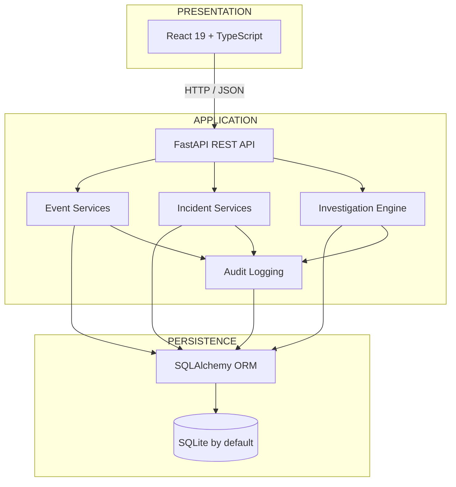
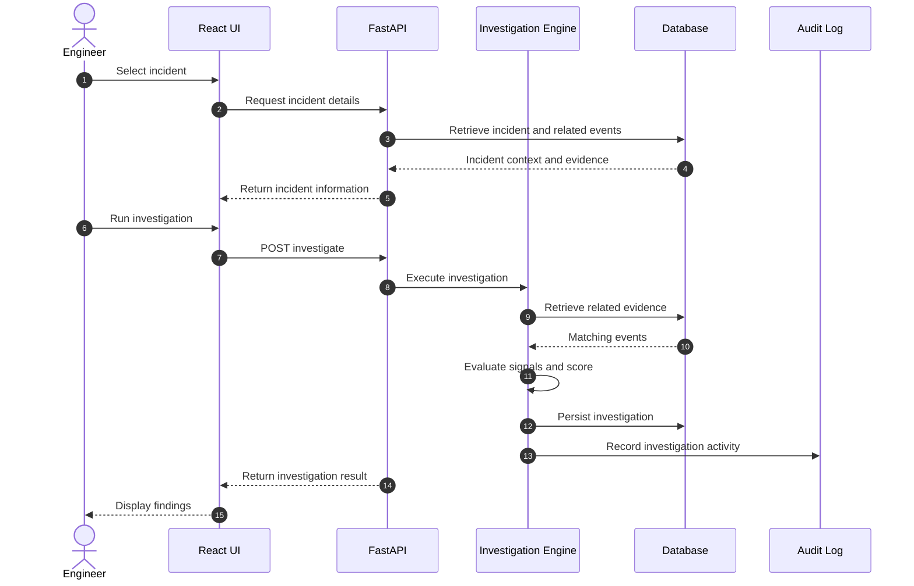
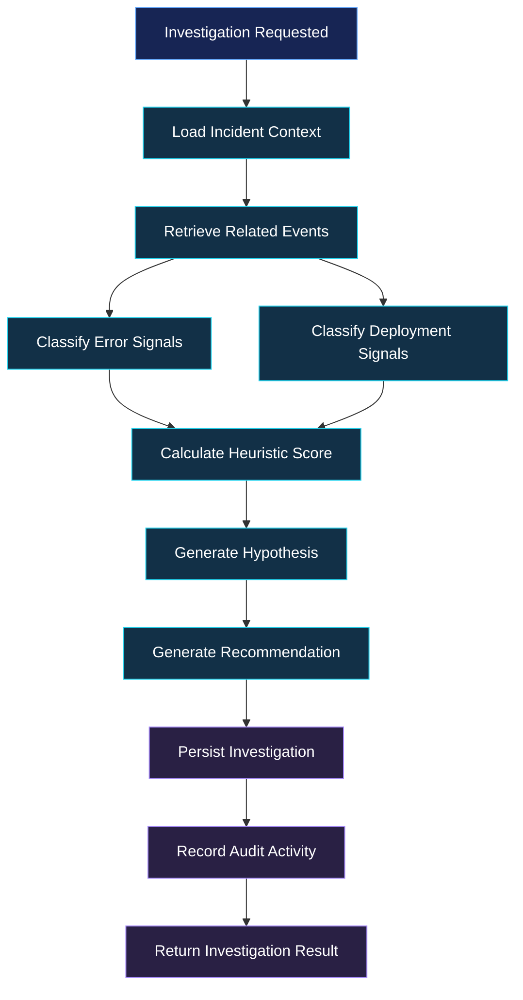
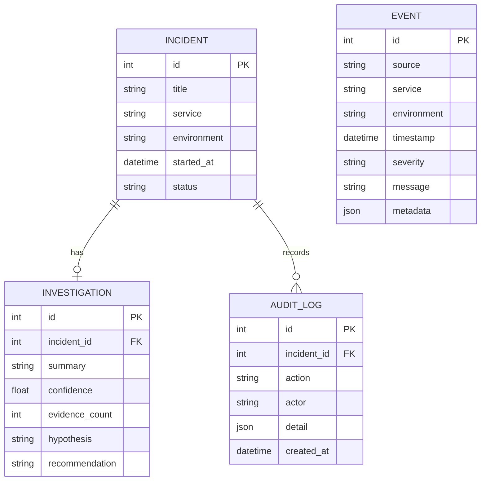

 <div align="center">

# ◈ OPSPILOT AI

### EVIDENCE-FIRST OPERATIONS INTELLIGENCE

**From operational signals to structured incident investigations.**

A full-stack incident investigation platform built to collect operational events, correlate incident evidence, evaluate signals, generate deterministic findings, and preserve an auditable investigation history.

[GitHub Repository](https://github.com/akankshad1712/opspilot-ai) · [Developer Profile](https://github.com/akankshad1712) · [LinkedIn](https://linkedin.com/in/akanksha-deshmukh-26210b244) · [Portfolio](https://akankshadeshmukh.com)


</div>

---

## 01 — PRODUCT VISION

### Operational data is abundant. Actionable context is harder to find.

Modern applications generate events across services, environments, deployments, and infrastructure components. When something fails, engineers must reconstruct what happened from fragmented operational signals.

OpsPilot AI addresses one part of that workflow: **turning related operational events into a structured, inspectable incident investigation.**

The platform provides a consistent workflow to:

- Ingest structured operational events.
- Create and manage incidents.
- Retrieve related evidence using service, environment, and time context.
- Evaluate error and deployment signals.
- Generate deterministic investigation findings.
- Persist investigation results.
- Maintain an audit trail of important activities.

### Product principles

| Principle | Engineering interpretation |
|---|---|
| Evidence first | Findings are based on retrieved operational events |
| Explicit logic | Investigation scoring follows inspectable rules |
| Context matters | Service, environment, and time constrain evidence |
| Traceability | Important activities are recorded in audit history |
| Clear boundaries | Correlation is not presented as proven causation |

---

## 02 — SYSTEM CAPABILITIES

| Capability | Current implementation |
|---|---|
| Event ingestion | FastAPI event endpoint |
| Incident management | Incident creation and retrieval |
| Evidence retrieval | Service, environment, and time-window filtering |
| Signal analysis | Error and deployment signal detection |
| Investigation | Deterministic rule-based engine |
| Confidence scoring | Bounded heuristic score |
| Recommendations | Rule-generated investigation suggestions |
| Persistence | SQLAlchemy models and database storage |
| Audit history | Event, incident, and investigation activity |
| Web interface | React incident investigation dashboard |
| Background processing | Separate optional polling worker |

---

## 03 — SYSTEM ARCHITECTURE

### High-level architecture



### Component responsibilities

| Component | Responsibility |
|---|---|
| React frontend | Incident exploration and investigation presentation |
| FastAPI | HTTP routing and request handling |
| Event services | Event persistence and ingestion activity |
| Incident services | Incident creation and retrieval |
| Investigation engine | Evidence selection, signal analysis, and findings |
| SQLAlchemy | Database access and ORM relationships |
| Database | Persistent application records |
| Worker | Optional periodic investigation of open incidents |

### Request lifecycle



---

## 04 — INVESTIGATION ENGINE

### Evidence selection

The investigation engine narrows the available event set using three conditions:

1. **Service:** event service must match the incident service.
2. **Environment:** event environment must match the incident environment.
3. **Time:** event timestamp must fall within the configured investigation window.

| Window boundary | Current behavior |
|---|---|
| Before incident start | 30 minutes |
| After incident start | 2 hours |
| Ordering | Timestamp ascending |

### Signal classification

The current engine identifies:

| Signal | Detection rule |
|---|---|
| Error signal | Severity is `ERROR` or `CRITICAL` |
| Deployment signal | Source is `deployment`, `deploy`, or `release` |

### Deterministic confidence scoring

The current implementation uses a bounded heuristic:

| Scoring component | Contribution |
|---|---:|
| Initial baseline | +0.25 |
| Each error or critical event | +0.05 |
| Maximum error contribution | +0.30 |
| Deployment signal when errors also exist | +0.25 |
| Maximum final score | 0.95 |

Conceptually:

```python
score = 0.25

score += min(error_count * 0.05, 0.30)

if has_deployment and has_errors:
    score += 0.25

score = min(score, 0.95)
```

The final implementation rounds the score to two decimal places.

### Investigation lifecycle



### Interpretation boundaries

The score is a deterministic heuristic, not a calibrated probability.

A deployment occurring near an error indicates temporal correlation, not proof that the deployment caused the error.

Recommendations are suggestions. The current engine does not execute remediation.

---

## 05 — DATA MODEL



| Entity | Purpose |
|---|---|
| Event | Stores operational event information |
| Incident | Represents an operational incident |
| Investigation | Stores generated investigation findings |
| AuditLog | Records important application activities |

An incident has a one-to-one investigation relationship. Audit records are associated with incidents. Events are retrieved through matching attributes and time criteria.

---

## 06 — REST API CONTRACT

**Base URL:** `http://127.0.0.1:8000`

| Method | Endpoint | Purpose |
|---|---|---|
| GET | `/health` | Health check |
| POST | `/api/v1/events` | Ingest an event |
| GET | `/api/v1/events` | Retrieve events |
| POST | `/api/v1/incidents` | Create an incident |
| GET | `/api/v1/incidents` | List incidents |
| GET | `/api/v1/incidents/{incident_id}` | Retrieve incident details |
| POST | `/api/v1/incidents/{incident_id}/investigate` | Run investigation |
| GET | `/api/v1/incidents/{incident_id}/audit` | Retrieve audit history |

Interactive API documentation:

`http://127.0.0.1:8000/docs`

---

## 07 — FRONTEND EXPERIENCE

The React dashboard provides an interface for working with the incident investigation workflow.

**Implemented interface capabilities**

- Incident list and incident selection.
- Incident detail presentation.
- Related evidence timeline.
- Investigation execution through the interface.
- Confidence score display.
- Investigation summary and hypothesis.
- Recommendation display.

The current frontend uses a local API base URL of `http://localhost:8000`.

---

## 08 — TECHNOLOGY STACK

| Layer | Technology |
|---|---|
| Backend language | Python 3.12 |
| API framework | FastAPI 0.115 |
| Validation and settings | Pydantic / Pydantic Settings |
| ORM | SQLAlchemy 2.0 |
| Default database | SQLite |
| Database driver dependency | psycopg |
| Frontend | React 19 |
| Frontend language | TypeScript 5.7 |
| Build tooling | Vite 6 |
| API server | Uvicorn |
| Backend testing | Pytest |
| HTTP testing | HTTPX |
| Coverage | Coverage.py |
| Containerization | Docker |
| Local orchestration | Docker Compose |

---

## 09 — REPOSITORY STRUCTURE

```text
opspilot-ai/
│
├── apps/
│   ├── api/
│   │   └── app/
│   │       ├── config.py
│   │       ├── database.py
│   │       ├── engine.py
│   │       ├── main.py
│   │       ├── models.py
│   │       ├── schemas.py
│   │       └── services.py
│   │
│   ├── web/
│   │   ├── src/
│   │   │   ├── App.tsx
│   │   │   ├── main.tsx
│   │   │   └── styles.css
│   │   ├── package.json
│   │   └── vite.config.ts
│   │
│   └── worker/
│       └── main.py
│
├── tests/
│   └── test_api.py
│
├── docs/
├── data/
├── .env.example
├── .gitignore
├── Dockerfile
├── docker-compose.yml
├── requirements.txt
└── README.md
```

---

## 10 — LOCAL DEVELOPMENT

### Prerequisites

- Python 3.12
- Node.js 22
- npm
- Git
- Docker (optional)

### Windows PowerShell setup

**Step 1 — Clone**

```powershell
git clone https://github.com/akankshad1712/opspilot-ai.git

cd opspilot-ai
```

**Step 2 — Create virtual environment**

```powershell
python -m venv .venv

.\.venv\Scripts\Activate.ps1
```

**Step 3 — Install backend dependencies**

```powershell
python -m pip install -r requirements.txt
```

**Step 4 — Create local environment configuration**

```powershell
Copy-Item .env.example .env
```

**Step 5 — Start backend**

```powershell
python -m uvicorn apps.api.app.main:app --reload
```

Backend: `http://127.0.0.1:8000`

Swagger: `http://127.0.0.1:8000/docs`

**Step 6 — Start frontend in another terminal**

```powershell
cd apps/web

npm install

npm run dev
```

Frontend: `http://localhost:5173`

### Docker setup

From the project root:

```powershell
Copy-Item .env.example .env

docker compose up --build
```

Stop:

```powershell
docker compose down
```

The current Compose configuration starts the API and web services. The optional worker runs separately.

---

## 11 — TESTING & VERIFICATION

Quality should be measurable and reproducible.

### Run backend tests

```powershell
python -m pytest -v
```

### Run backend coverage

Install Coverage.py if necessary:

```powershell
python -m pip install coverage
```

Execute:

```powershell
python -m coverage run --branch --source=apps.api.app -m pytest -v

python -m coverage report -m
```

### Verified test results

| Metric | Verified result |
|---|---:|
| Backend tests passed | 15 |
| Backend statement coverage | 100% |
| Backend branch coverage | 100% |
| Coverage scope | `apps.api.app` |

The test suite includes health checks, event operations, incident operations, investigation behavior, related-event filtering, repeated investigations, audit history, and database session cleanup.

**Scope note:** These coverage results apply to the backend application package. They do not establish frontend coverage or end-to-end coverage.

---

## 12 — ENGINEERING DECISIONS

| Decision | Rationale |
|---|---|
| FastAPI REST API | Explicit HTTP interface and request validation |
| SQLAlchemy ORM | Structured persistence and model relationships |
| SQLite default | Low-friction local development |
| Deterministic scoring | Reproducible and inspectable investigation logic |
| Time-window filtering | Limits evidence to relevant incident context |
| Separate investigation entity | Separates incident records from generated findings |
| Audit logging | Preserves a history of important application actions |
| React + TypeScript | Component-oriented frontend with static typing |
| Backend automated tests | Verifies core application behavior |

---

## 13 — CURRENT SCOPE & NON-GOALS

OpsPilot AI is an MVP focused on event ingestion, incident management, deterministic investigation, and audit history.

The following capabilities are **not currently implemented**:

| Capability | Status |
|---|---|
| Production LLM integration | Not implemented |
| AI-generated root-cause analysis | Not implemented |
| Kafka event streaming | Not implemented |
| Redis caching | Not implemented |
| Authentication and RBAC | Not implemented |
| Autonomous remediation | Not implemented |
| Human approval workflow | Not implemented |
| Production observability integrations | Not implemented |
| Frontend automated test suite | Not implemented |

These are potential future directions, not current product capabilities.

---

## 14 — PRODUCT ROADMAP


Potential engineering extensions:

- PostgreSQL deployment validation.
- Kafka-based event ingestion.
- Redis caching.
- Advanced event correlation.
- Evidence-linked AI-assisted analysis.
- Structured hypothesis evaluation.
- Authentication and role-based access control.
- Human approval workflows.
- Policy-controlled remediation.
- Frontend and end-to-end testing.
- Production observability integrations.

---

## 15 — AUTHOR

### Akanksha Deshmukh

**Software Developer | Backend & Full-Stack Engineering**

Interested in building practical software systems with backend engineering, API design, application architecture, and modern frontend technologies.

| Platform | Profile |
|---|---|
| GitHub | [akankshad1712](https://github.com/akankshad1712) |
| LinkedIn | [Professional Profile](https://linkedin.com/in/akanksha-deshmukh-26210b244) |
| Portfolio | [Personal Website](https://akankshadeshmukh.com) |
| LeetCode | [Kanksha17](https://leetcode.com/u/Kanksha17/) |

---

<div align="center">

### ◈ OPSPILOT AI

**Operational complexity, made investigable.**

Evidence first. Context always. Clarity by design.

Built with curiosity, engineering discipline, and a commitment to transparent software.

</div></div>

