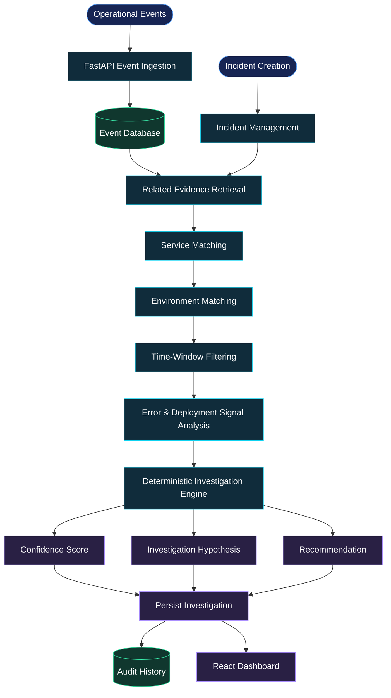
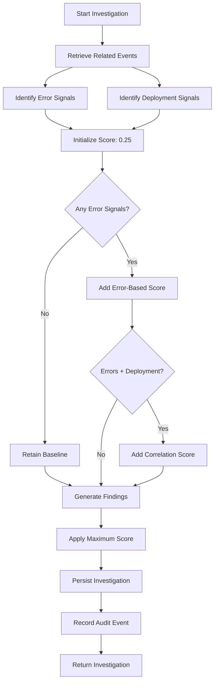
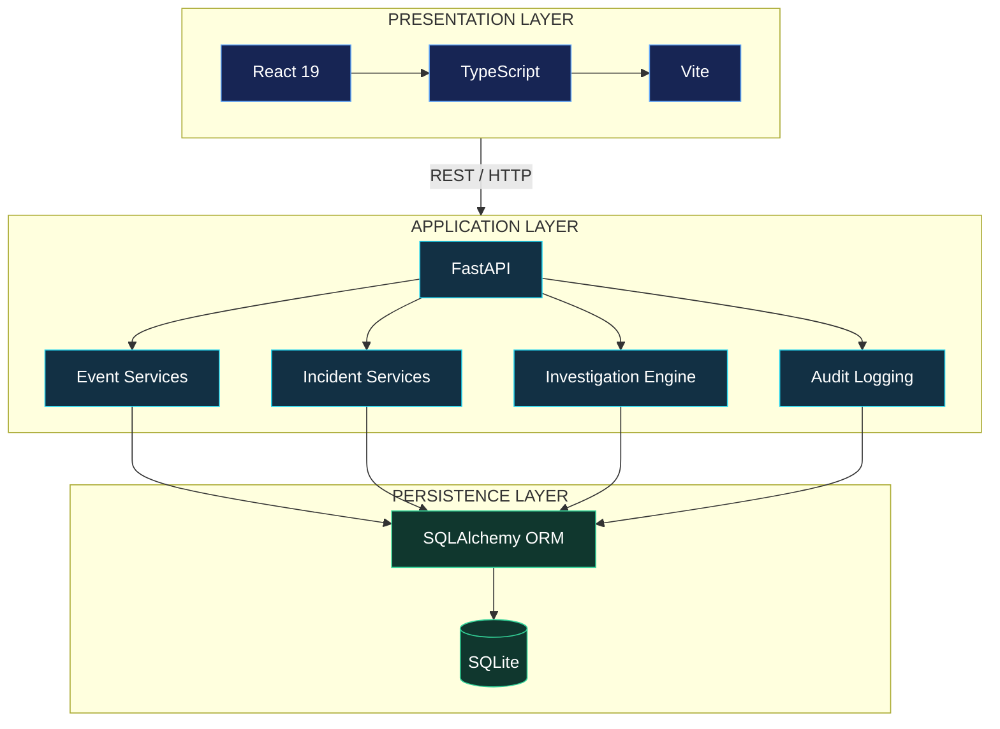
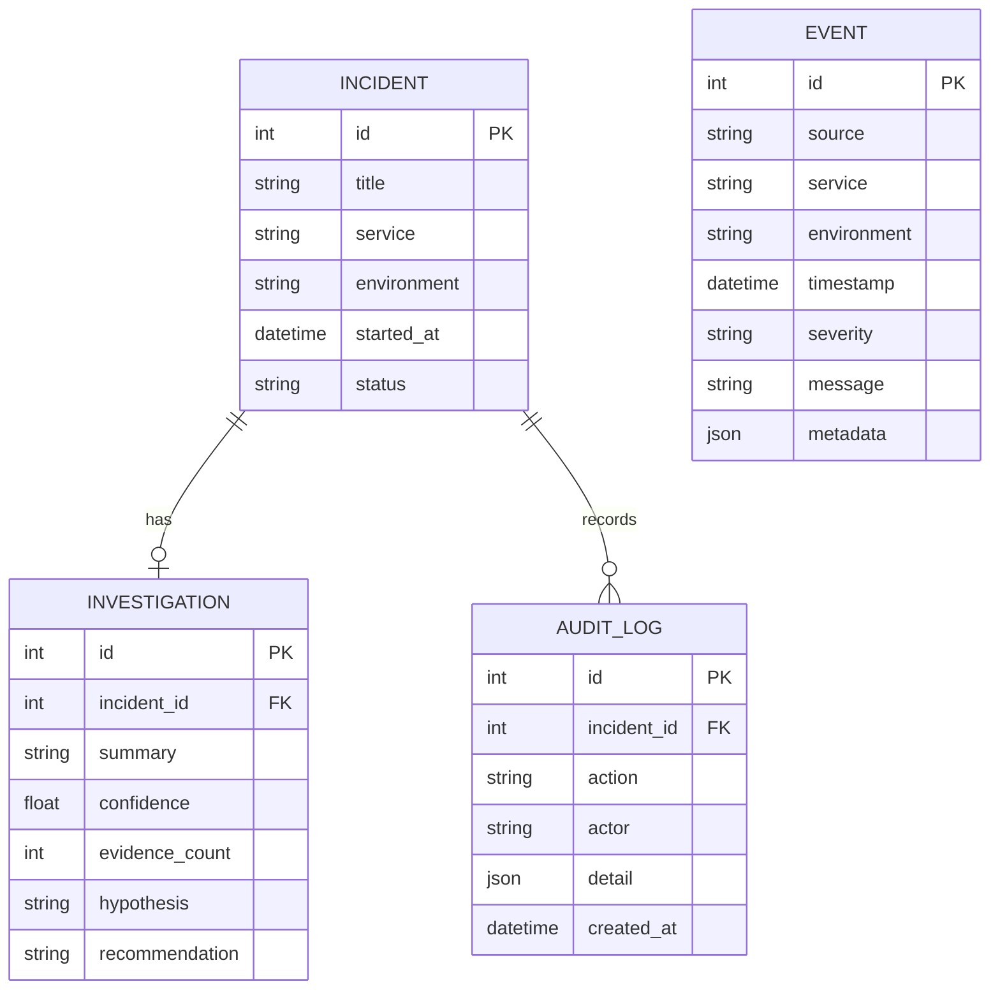

 <div align="center">

# ◈ OPSPILOT AI

### EVIDENCE-FIRST OPERATIONS INTELLIGENCE

**See the signal. Understand the incident. Follow the evidence.**

A modern incident investigation platform that transforms operational events into structured, evidence-backed insights.

<br/>

[](https://python.org/)
[](https://fastapi.tiangolo.com/)
[](https://react.dev/)
[](https://www.typescriptlang.org/)
[](https://www.sqlalchemy.org/)
[](LICENSE)

<br/>

[**Repository**](https://github.com/akankshad1712/opspilot-ai)
&nbsp; · &nbsp;
[**Author**](https://github.com/akankshad1712)
&nbsp; · &nbsp;
[**LinkedIn**](https://linkedin.com/in/akanksha-deshmukh-26210b244)
&nbsp; · &nbsp;
[**Portfolio**](https://akankshadeshmukh.com)

<br/>

</div>

---

<div align="center">

### THE PROBLEM IS NOT A LACK OF DATA.

### IT IS A LACK OF CONTEXT.

</div>

Modern software systems generate events continuously: application errors, deployment signals, service activity, and operational changes.

When an incident occurs, engineers need to determine:

- Which events are relevant?
- What happened before the incident?
- Are there correlated error or deployment signals?
- What does the available evidence support?
- What should be investigated next?

OpsPilot AI is built around this investigation problem.

It provides a structured workflow for collecting operational events, creating incidents, finding related evidence, evaluating signals, and recording investigation results.

> **Design principle:** Evidence before explanation. Context before conclusions. Traceability throughout the investigation.

---

# 01 / PRODUCT OVERVIEW

<div align="center">

### ONE INVESTIGATION WORKSPACE. FOUR CORE CAPABILITIES.

</div>

| Capability | What it does | Current implementation |
|---|---|---|
| Event Ingestion | Accepts structured operational events through an API | Implemented |
| Incident Management | Creates and retrieves incidents | Implemented |
| Evidence Correlation | Finds events related to an incident | Implemented |
| Investigation Engine | Evaluates signals and generates findings | Implemented |
| Confidence Scoring | Calculates a rule-based investigation score | Implemented |
| Recommendations | Generates evidence-based next-step suggestions | Implemented |
| Audit History | Records event, incident, and investigation activities | Implemented |
| Web Dashboard | Displays incidents, evidence, and investigation results | Implemented |

### The experience

```text
OPERATIONAL SIGNALS
        │
        ▼
EVENT INGESTION
        │
        ▼
INCIDENT CONTEXT
        │
        ▼
RELATED EVIDENCE
        │
        ▼
SIGNAL ANALYSIS
        │
        ▼
CONFIDENCE + HYPOTHESIS
        │
        ▼
RECOMMENDATION
        │
        ▼
AUDIT HISTORY
```

---

# 02 / VISUAL SYSTEM ARCHITECTURE

<div align="center">

### FROM RAW EVENTS TO INVESTIGATION INTELLIGENCE

</div>



### Architectural boundaries

The current application uses a deterministic investigation engine.

It does not currently use a production LLM to generate findings, execute remediation, or make autonomous operational decisions.

This distinction is intentional: the current investigation results are generated using explicit, inspectable rules.

---

# 03 / INVESTIGATION ENGINE

<div align="center">

### CORRELATE FIRST. INTERPRET SECOND.

</div>

The investigation engine is the core of OpsPilot AI.

It retrieves events associated with an incident and evaluates their relevance using three primary dimensions.

**01 — Service context**

Events must belong to the same service as the incident.

**02 — Environment context**

Events must match the incident's environment.

**03 — Temporal context**

Events are selected within the following investigation window:

| Boundary | Time |
|---|---:|
| Before incident start | 30 minutes |
| After incident start | 2 hours |

### Signal evaluation

The current scoring logic evaluates:

| Signal | Scoring behavior |
|---|---|
| Initial baseline | 0.25 |
| Each ERROR or CRITICAL event | +0.05 |
| Maximum error contribution | +0.30 |
| Deployment signal combined with errors | +0.25 |
| Maximum final score | 0.95 |

The score is capped at 0.95.

### Investigation decision flow



### Example investigation output

| Field | Example |
|---|---|
| Evidence count | Number of related events |
| Confidence | Calculated investigation score |
| Summary | Overview of observed signals |
| Hypothesis | Possible explanation based on signals |
| Recommendation | Suggested next investigation step |

**Important:** The confidence value is a deterministic heuristic score. It is not a statistically calibrated probability or a guarantee that a hypothesis is correct.

A deployment occurring near an error is treated as a temporal correlation, not proof of causation.

---

# 04 / APPLICATION ARCHITECTURE

<div align="center">

### SEPARATION OF CONCERNS. CLEAR RESPONSIBILITIES.

</div>



### Component responsibilities

| Component | Responsibility |
|---|---|
| React application | Incident dashboard and investigation presentation |
| FastAPI | HTTP endpoints and request handling |
| Event services | Event persistence and ingestion audit |
| Incident services | Incident creation and retrieval |
| Investigation engine | Evidence selection, scoring, and findings |
| SQLAlchemy | Database access and ORM mapping |
| SQLite | Default persistent database |
| Worker | Optional background investigation process |

---

# 05 / TECHNOLOGY STACK

<div align="center">

### A PRACTICAL FULL-STACK ENGINEERING FOUNDATION.

</div>

| Layer | Technology | Purpose |
|---|---|---|
| Language | Python 3.12 | Backend |
| API Framework | FastAPI 0.115 | REST services |
| Validation | Pydantic | Request and response models |
| ORM | SQLAlchemy 2.0 | Persistence |
| Database | SQLite | Default storage |
| Database Driver | psycopg | PostgreSQL connectivity dependency |
| Frontend | React 19 | User interface |
| Language | TypeScript 5.7 | Frontend development |
| Build Tool | Vite 6 | Frontend development server |
| API Server | Uvicorn | ASGI application server |
| Testing | Pytest | Backend tests |
| HTTP Testing | HTTPX | API test client |
| Containers | Docker | Container support |
| Orchestration | Docker Compose | Local API and frontend services |
| Version Control | Git and GitHub | Source management |

---

# 06 / REST API REFERENCE

<div align="center">

### RESOURCE-ORIENTED API DESIGN

</div>

**Base URL**

```text
http://127.0.0.1:8000
```

### Health

| Method | Endpoint | Description |
|---|---|---|
| GET | `/health` | Check API health |

### Events

| Method | Endpoint | Description |
|---|---|---|
| POST | `/api/v1/events` | Ingest an event |
| GET | `/api/v1/events` | Retrieve events |

### Incidents

| Method | Endpoint | Description |
|---|---|---|
| POST | `/api/v1/incidents` | Create an incident |
| GET | `/api/v1/incidents` | List incidents |
| GET | `/api/v1/incidents/{incident_id}` | Retrieve incident details and evidence |

### Investigations

| Method | Endpoint | Description |
|---|---|---|
| POST | `/api/v1/incidents/{incident_id}/investigate` | Run an investigation |

### Audit

| Method | Endpoint | Description |
|---|---|---|
| GET | `/api/v1/incidents/{incident_id}/audit` | Retrieve incident audit history |

### Interactive API documentation

Once the backend is running:

**[OPEN SWAGGER UI →](http://127.0.0.1:8000/docs)**

---

# 07 / DATA MODEL

<div align="center">

### A PERSISTENT MODEL FOR EVENTS, INCIDENTS AND INVESTIGATIONS.

</div>



### Core entities

| Entity | Purpose |
|---|---|
| `Event` | Stores operational event information |
| `Incident` | Stores incident context and status |
| `Investigation` | Stores investigation findings and scores |
| `AuditLog` | Stores event, incident, and investigation activity |

The investigation model has a one-to-one relationship with an incident.

Events are retrieved using matching service, environment, and timestamp criteria.

---

# 08 / FRONTEND EXPERIENCE

The React dashboard provides an interface for exploring incident investigations.

### Current interface capabilities

- View the incident list.
- Select an incident.
- Inspect incident details.
- View related evidence in a timeline.
- Run an investigation.
- Display the investigation confidence score.
- Review the summary, hypothesis, and recommendation.
- Refresh incident information.

### Interface structure

```text
┌──────────────────────────────────────────────────────┐
│ OPSPILOT AI                         OPERATIONS CONTROL│
├────────────────┬─────────────────────────────────────┤
│                │                                     │
│  Incidents     │  Incident Intelligence              │
│                │                                     │
│  Evidence      │  Open Incidents                     │
│                │                                     │
│  Audit Trail   │  Incident Details                   │
│                │                                     │
│                │  Investigation Results              │
│                │                                     │
│                │  Confidence / Summary               │
│                │                                     │
│                │  Evidence Timeline                  │
│                │                                     │
└────────────────┴─────────────────────────────────────┘
```

---

# 09 / PROJECT STRUCTURE

```text
opspilot-ai/
│
├── apps/
│   ├── api/
│   │   └── app/
│   │       ├── __init__.py
│   │       ├── config.py
│   │       ├── database.py
│   │       ├── engine.py
│   │       ├── main.py
│   │       ├── models.py
│   │       ├── schemas.py
│   │       └── services.py
│   │
│   ├── web/
│   │   ├── src/
│   │   │   ├── App.tsx
│   │   │   ├── main.tsx
│   │   │   └── styles.css
│   │   ├── index.html
│   │   ├── package.json
│   │   ├── package-lock.json
│   │   ├── tsconfig.json
│   │   └── vite.config.ts
│   │
│   └── worker/
│       └── main.py
│
├── data/
│
├── docs/
│   ├── architecture.md
│   ├── data-model.md
│   ├── operations.md
│   └── security.md
│
├── tests/
│   └── test_api.py
│
├── .env.example
├── .gitignore
├── Dockerfile
├── docker-compose.yml
├── requirements.txt
├── LICENSE
└── README.md
```

---

# 10 / LOCAL DEVELOPMENT

<div align="center">

### RUN THE COMPLETE APPLICATION LOCALLY.

</div>

## Prerequisites

| Dependency | Recommended version |
|---|---|
| Python | 3.12 |
| Node.js | 22 |
| npm | Included with Node.js |
| Git | Recent stable version |
| Docker | Optional |

## Step 01 — Clone the repository

```bash
git clone https://github.com/akankshad1712/opspilot-ai.git

cd opspilot-ai
```

## Step 02 — Create the Python environment

**Windows PowerShell**

```powershell
python -m venv .venv

.\.venv\Scripts\Activate.ps1
```

## Step 03 — Install backend dependencies

```powershell
pip install -r requirements.txt
```

## Step 04 — Configure environment variables

Create your local environment file:

```powershell
Copy-Item .env.example .env
```

Default configuration:

```env
DATABASE_URL=sqlite:///./opspilot.db
API_HOST=0.0.0.0
API_PORT=8000
CORS_ORIGINS=http://localhost:5173
```

## Step 05 — Start the backend

From the project root:

```powershell
python -m uvicorn apps.api.app.main:app --reload
```

Backend:

```text
http://127.0.0.1:8000
```

Swagger:

```text
http://127.0.0.1:8000/docs
```

## Step 06 — Start the frontend

Open another terminal:

```powershell
cd apps/web
```

Install dependencies:

```powershell
npm install
```

Start the frontend:

```powershell
npm run dev
```

Frontend:

```text
http://localhost:5173
```

## Step 07 — Verify the application

Open:

- Frontend: `http://localhost:5173`
- Backend health: `http://127.0.0.1:8000/health`
- API explorer: `http://127.0.0.1:8000/docs`

---

# 11 / DOCKER DEVELOPMENT

Docker Compose is provided for local API and frontend startup.

First, create the environment file:

```powershell
Copy-Item .env.example .env
```

Then run:

```bash
docker compose up --build
```

Services:

| Service | Local address |
|---|---|
| API | `http://localhost:8000` |
| API documentation | `http://localhost:8000/docs` |
| Web application | `http://localhost:5173` |

Stop the services:

```bash
docker compose down
```

The current Compose configuration runs the API and web services. The worker is a separate application process.

---

# 12 / TESTING & QUALITY

<div align="center">

### ENGINEERING QUALITY SHOULD BE VERIFIABLE.

</div>

OpsPilot AI includes an automated backend test suite.

### Run tests

```powershell
python -m pytest -v
```

### Run backend coverage

Install Coverage.py if it is not already installed:

```powershell
pip install coverage
```

Execute:

```powershell
python -m coverage run --branch --source=apps.api.app -m pytest -v

python -m coverage report -m
```

### Verified backend results

<table>
<tr>
<td align="center">

### 15

Passing tests

</td>
<td align="center">

### 100%

Statement coverage

</td>
<td align="center">

### 100%

Branch coverage

</td>
</tr>
</table>

**Coverage scope:** `apps.api.app`

The verified backend suite covers:

- API health checks.
- Event creation and retrieval.
- Incident creation and retrieval.
- Missing incident handling.
- Investigation behavior.
- Related-event filtering.
- Repeated investigation updates.
- Audit history.
- Database session cleanup.

These results describe the backend package only. They do not represent frontend test coverage.

---

# 13 / ENGINEERING DECISIONS

| Decision | Reasoning |
|---|---|
| FastAPI | Clear, typed REST API development |
| SQLAlchemy | Structured persistence and model relationships |
| SQLite default | Simple local development setup |
| Deterministic investigation | Reproducible and inspectable behavior |
| Explicit time window | Limits evidence to relevant incident context |
| Separate investigation model | Keeps incident state and investigation results distinct |
| Audit records | Makes important application activity traceable |
| React + TypeScript | Component-based user interface development |
| Automated backend tests | Verifies core application behavior |

### Important design distinction

The current confidence score is a heuristic based on selected event signals.

It should not be interpreted as a calibrated probability, root-cause proof, or production reliability metric.

---

# 14 / CURRENT SCOPE & LIMITATIONS

<div align="center">

### TRANSPARENT ENGINEERING. NO INFLATED CLAIMS.

</div>

OpsPilot AI is currently an MVP focused on event ingestion, incident management, deterministic investigation, and audit history.

The following capabilities are not implemented in the current application:

| Capability | Status |
|---|---|
| Production LLM integration | Not implemented |
| AI-generated root-cause analysis | Not implemented |
| Kafka event streaming | Not implemented |
| Redis caching | Not implemented |
| Authentication and RBAC | Not implemented |
| Autonomous remediation | Not implemented |
| Human approval workflow | Not implemented |
| Production observability integrations | Not implemented |
| Frontend automated test suite | Not implemented |

The investigation engine generates rule-based hypotheses and recommendations. It does not execute remediation actions.

These boundaries are documented so that the current implementation can be evaluated accurately.

---

# 15 / ROADMAP

<div align="center">

### FROM INVESTIGATION FOUNDATION TO ADVANCED OPERATIONS INTELLIGENCE.

</div>


### Planned enhancements

- [ ] PostgreSQL deployment validation
- [ ] Kafka-based event streaming
- [ ] Redis caching
- [ ] Advanced event correlation
- [ ] Evidence-linked AI-assisted analysis
- [ ] Structured hypothesis evaluation
- [ ] Authentication and role-based access control
- [ ] Human approval workflows
- [ ] Policy-controlled remediation
- [ ] Frontend automated tests
- [ ] Integration and end-to-end testing
- [ ] Production observability integrations

---

# 16 / DOCUMENTATION

| Resource | Description |
|---|---|
| [Architecture](docs/architecture.md) | Application architecture |
| [Data Model](docs/data-model.md) | Data model documentation |
| [Operations](docs/operations.md) | Operational guidance |
| [Security](docs/security.md) | Security considerations |
| [Security Policy](SECURITY.md) | Repository security policy |

---

# 17 / AUTHOR

<div align="center">

## AKANKSHA DESHMUKH

### SOFTWARE DEVELOPER

Interested in backend engineering, full-stack development, API design, application architecture, and building practical software systems.

<br/>

[](https://github.com/akankshad1712)

[](https://linkedin.com/in/akanksha-deshmukh-26210b244)

[](https://akankshadeshmukh.com)

[](https://leetcode.com/u/Kanksha17/)

</div>

---

<div align="center">

# ◈ OPSPILOT AI

### OPERATIONAL COMPLEXITY, MADE INVESTIGABLE.

**Evidence first. Context always. Clarity by design.**

<br/>

Built with curiosity, engineering discipline, and a commitment to transparent software.

<br/>

<sub>© 2026 Akanksha Deshmukh · MIT License</sub>

</div>
